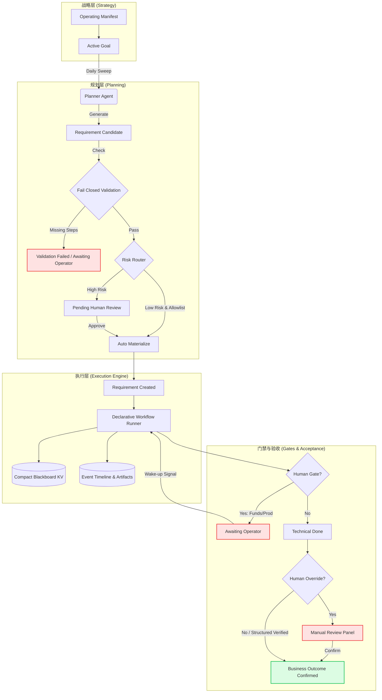

# Synapse-Network-Growing Architecture Constraints

This file is the short, tool-neutral constitution for AI coding assistants working in this repository.

Read it before changing workflow, planning, scheduler, release, notification, runtime, security, auth, finance, settlement, or production-delivery code.

Canonical sources:

1. `AGENTS.md`
2. `docs/design-docs/system-design-principles.md`
3. `docs/design-docs/declarative-agent-workflow-factory.md`
4. `docs/design-docs/planning-lifecycle-operating-manifest.md`
5. `docs/design-docs/recurring-workflow-control-plane.md`
6. `docs/design-docs/workflow-factory-frontend-control-plane.md`
7. `docs/design-docs/frontend-control-plane-figma-implementation.md`
8. `docs/design-docs/current-feature-inventory.md`

Historical plans, validation notes, and retired design drafts live under `docs/archive/`. Archived files are evidence, not active requirements.

## System Architecture Flow

## 1. Core Philosophy

1. Agent is the engine. Declarative state machine spec is the rail. Human operator is the high-risk gate.
2. The system must carry non-deterministic intelligence on deterministic rails.
3. Fail closed. If policy, evidence, schema, budget, or state is unclear, route to `awaiting_operator`.
4. Do not build a God Agent that owns global control flow.

## 2. Role Boundaries

1. Watcher may read signals, logs, metrics, webhooks and schedules.
2. Watcher may create or update `RequirementCandidate`, `Requirement`, error fingerprints, notification events, and run history.
3. Watcher must not write code, patch files, move funds, deploy, approve gates, or publish external content.
4. Planner Sweep is stateless. It reads active Operating Manifest and aggregate progress, then creates `RequirementCandidate` records only.
5. Planner must not directly create official requirements unless the candidate was operator-approved and explicitly materialized.
6. Agent Atom may reason, diagnose, draft, patch, summarize, or recommend through structured output.
7. Agent Atom must not mutate workflow state directly.
8. Deterministic Runner owns state transitions, retry budget, terminal state, evidence persistence, and human gate routing.
9. Oracle is the operator-facing control plane. Agents may recommend approval decisions but must not write final approval status.

## 3. Workflow Constraints

1. Complex workflow control flow must be represented as declarative state machine spec.
2. New complex flows must not be hidden inside long Python `if/else` orchestration.
3. Built-in Python specs are acceptable only as implementation detail while the YAML/spec loader matures; the behavior must still be inspectable as a state machine.
4. Every loop must have a retry budget, terminal state, and operator fallback.
5. Verification must be independent from execution.
6. Execution self-repair must stay in the same workflow run/session and stop after budget exhaustion.
7. Raw agent output must be persisted as artifact; downstream deterministic atoms may only trust parsed/schema-valid payload.
8. Legacy `/api/tasks`, `/api/approvals`, fixed-step orchestrator, and old task runner are retired. Do not reintroduce TaskBoard-style execution or fixed `workflow_steps` as product behavior.
9. Do not mask state inconsistency in projection APIs or frontend conditionals. Fix the state machine transition root cause.
10. Human Gate decisions are state machine inputs. After a decision, the runner must wake up and converge the workflow to the next state, a new gate, or a clear failed terminal state.
11. Human Override reduces manual requirement form friction; it does not mean business acceptance is complete. A technically succeeded override workflow remains awaiting business confirmation until the operator explicitly confirms the outcome.
12. Long-running final regression must not block workflow workers. Workflow should pause in `awaiting_ci`; marker-file CI and `ci_status_sweep` own asynchronous completion, evidence, and operator fallback.

## 4. Planning Lifecycle Constraints

1. There must be exactly one active Operating Manifest, represented by `active_slot="global"`.
2. `OperatingManifest` is the control plane only: budget, focus weights, global constraints, and other short steering fields.
3. `PlanningGoal` is the first-class business intent data plane: title, long Markdown PRD, success metric, acceptance steps, project binding, and workflow binding.
4. Goals only use `active | achieved | dropped`.
5. `goal_key` is stable lineage and must flow through goal-derived candidates, requirements, workflow runs, and release records.
6. Do not reintroduce `payload.goals` or long Markdown into Manifest JSON. APIs must reject embedded goals and direct operators to `/api/planning/goals`.
7. Mission Control returns goal map data and a short `intent_excerpt` only. Full `intent_markdown` may only be loaded through `GET /api/planning/goals/{id}`.
8. Planner Sweep must read the compact goal map first, then inject only the single goal's full context when generating that goal's candidate.
9. Do not make Planner a long-lived PM agent. Rollups must be computed from database lineage.
10. Dropped goals must not generate new candidates.
11. Drop Goal means stop future investment and safe-halt unfinished work.
12. Drop Goal never triggers rollback, revert, database deletion, unpublish, or delivered release mutation.
13. Decommissioning delivered functionality is a new requirement with normal workflow, verification, human gate, and release.
14. Release Task records release intent and human closure only; Deployment Record records physical deploy execution. Do not merge deployment logs into the release task list or let release tasks trigger deploy/rollback without a Human Gate.
14. Planning UI is goal-centric. Do not reintroduce flat Manifest JSON plus detached Candidate queue as the primary surface.
15. Operating Manifest is business intent, not execution automation policy. Automation permission belongs to deterministic candidate risk routing and workflow/project policy.
16. Planner-created candidates may be auto-materialized only when a deterministic router proves the workflow, risk level, project policy, and atom profile are safe.
17. Planner Agent must synthesize evidence-bound candidates from one Goal Markdown PRD at a time; it may repair malformed JSON twice, but unsafe commands, unknown workflow keys, or invalid acceptance must fail closed.
18. Planner Agent `workflow_key` output must be an enum choice from registered workflow definitions, not free text.
19. Planner Agent `required_commands` must pass the safe command allowlist / denylist before any candidate can materialize.
    Local dashboard E2E evidence is allowed only through bounded project scripts such as `cd dashboard && npm run test:e2e` or `npm --prefix dashboard run test:e2e`; do not allow arbitrary Playwright, `npx`, external network, or shell execution.
    Planner-generated pytest acceptance commands must target explicit test files or selectors. Broad live workflow commands such as `pytest tests -q`, `pytest -q`, or `python -m pytest -q` are forbidden; full-suite regression belongs to the Final Regression CI runner.
    Git evidence commands are read-only only: `git diff --check` and `git diff --stat` are allowed; `git push/reset/checkout` remain forbidden.
20. Planner Agent must declare `expected_outcome=code_delivery|verification_only` at Candidate time. Workflow execution may not invent or downgrade this later.
21. `code_delivery` requires repository changes before PR handoff; no diff must fail closed. `verification_only` may complete without a PR only when evidence-bound verification is complete.
22. `Supersede & Retry Planner` must inject a one-sweep `context_hint` explaining the superseded no-change attempt so Planner can re-evaluate repo state and avoid repeating a stale `code_delivery` loop.

## 5. Human Gate And Kill-Switch Constraints

These actions always require a human gate:

1. Production deploy.
2. Funds movement, refund, withdrawal, settlement, ledger, vault, or USDC transfer.
3. Settlement logic change.
4. Smart contract interaction or contract change.
5. Auth, credential, permission, or secret changes.
6. External paid spend.
7. Self-modifying system deployment.
8. Any action above the active manifest budget threshold.

High evidence does not bypass high risk.

## 6. Observability Constraints

1. Every background loop, recurring workflow, scheduler, dispatcher, retry, and queue must be visible in Ops Console.
2. Every automation run must write run history, status, inputs, result, error excerpt, started/completed timestamps, and duration.
3. CI runners must stream logs to disk and write atomic exit markers; status sweeps must read bounded tails only and enforce a runtime cap.
4. Do not send ordinary state transitions, atom success, artifacts, or blackboard snapshots to Lark.
5. P0/P1 interruption goes to alert. Human gate goes to approval. PR/release goes to release. Workflow summary goes to workflow notification.
6. Notification suppression and requirement materialization suppression are separate systems.
7. Lark is webhook-only in v1: no Lark OpenAPI thread replies or card updates. Cards must carry bounded root-cause excerpts and deep links back to Ops Console.
8. Digest-only lifecycle events stay in notification history but do not page Lark. `runner_stale` must independently alert when a running workflow stops updating.

## 7. Zero Tolerance And Fail-Closed Acceptance

1. No acceptance fallbacks. Do not generate default shell criteria, generic "requested outcome is implemented" statements, or fake evidence to keep a workflow moving.
2. Planner or Candidate materialization must include valid `execution_acceptance_steps` before creating a Requirement.
3. Each acceptance step must prove the business outcome through `required_commands` or closed-vocabulary `required_evidence_types`; `required_db_lineage` is informational only in v1 and must not drive dynamic DB queries. Evidence asks must be supportable by the step commands or deterministic workflow artifacts: for example, `coverage_report` needs `diff-cover` / `coverage.xml` / `pytest --cov`, `frontend_validation_result` needs dashboard/npm validation, and `project_change_summary` must be tied to `code_delivery` or git diff evidence, never DB lineage alone.
4. Missing, malformed, empty, or vague Agent-generated acceptance must become `validation_failed` or `awaiting_operator`; it must not be silently repaired by code.
5. Acceptance criteria verify the business result, not that the workflow engine happened to transition through states.
6. Human Override is only for manually created requirements with a concrete `manual_review_prompt`; it still requires explicit business outcome confirmation.
7. Verification Agent `inconclusive` must remain non-passing unless a deterministic command/evidence check independently proves the required acceptance.
8. Acceptance Matrix Is Executable Contract: Planner-generated `execution_acceptance_steps.required_commands` must run in workflow verify, and `verification.status=passed` must depend on `acceptance_matrix.status=passed`.
9. Timeout mandatory, liveness diagnostic only: Planner-generated acceptance commands must run with deterministic hard timeouts. Liveness and heartbeat fields are diagnostic only; they never replace exit-code evidence or timeout failure.
10. Default smoke tests cannot replace the Planner contract. Guardrails, `py_compile`, and full pytest are system baselines; they do not satisfy requirement-specific acceptance steps unless those steps have matching evidence in the same `workflow_run_id`.

## 8. Frontend Constraints

1. Frontend is a Human-Agent Control Plane, not a mosaic of equal white cards or a CRUD admin clone.
2. Dangerous actions must use explicit confirmation UI, not browser-native `alert` or `confirm`.
3. Pages must explain purpose, inputs, outputs, evidence, current state, and next action.
4. Raw JSON belongs in debug views, not the default operator path.
5. Figma/Stitch prototypes define the current visual direction: dark cockpit, restrained density, machine-readable evidence, and clear Human Oracle gates.
6. Workflow detail must expose Agent outputs, command evidence, file changes, blackboard summaries, delivery status, and pending human gates.
7. Factory pages are read-only until workflow spec versioning, schema validation, sandbox execution, and human approval are production-ready.
8. Planning primary views must use progressive disclosure for Goal PRDs, Candidate Markdown, Planner raw output, and debug payloads. Dense goal lanes may show excerpts and reasons only.
9. Fail-Closed candidates are diagnostic drafts, not active work. They must be collapsed under Planner Intercepts by default and surface the blocking reason before any raw Agent text.
10. Workflow Human Gate views must be decision-first. Default UI shows what happened, root cause, recommended next action, and debounced decision buttons; raw state, resolution, Lark payload, notification fingerprints, and blackboard JSON belong in technical details or Debug only.
11. Human Gate decision success is not final convergence. Without WebSocket, the workflow detail UI must short-poll after a decision and surface renewed `awaiting_operator` states explicitly. Delivery summary must be gated by trusted delivery/release status before showing PR or branch fields.

## 9. When In Doubt

1. Prefer smaller deterministic control surfaces over stronger autonomous agents.
2. Prefer candidate buffers over direct side effects.
3. Prefer human gate over silent automation for high-risk paths.
4. Prefer docs + tests + observable evidence over prose-only policy.
