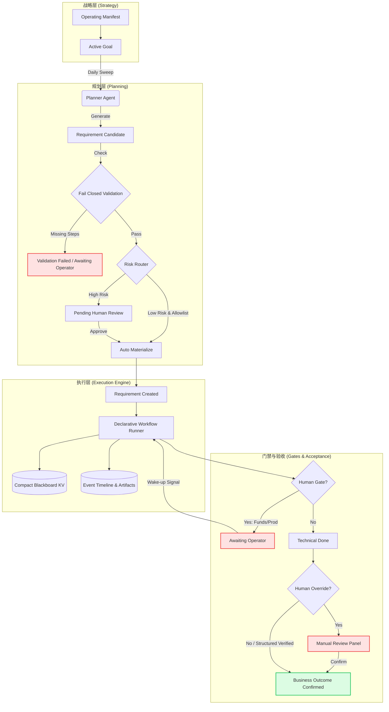

# Synapse-Network-Growing Architecture Constraints

This file is the short, tool-neutral constitution for AI coding assistants working in this repository.

Read it before changing workflow, planning, scheduler, release, notification, runtime, security, auth, finance, settlement, or production-delivery code.

Canonical sources:

1. `AGENTS.md`
2. `docs/design-docs/system-design-principles.md`
3. `docs/design-docs/context-loading-map.md`
4. `docs/design-docs/declarative-agent-workflow-factory.md`
5. `docs/design-docs/planning-lifecycle-operating-manifest.md`
6. `docs/design-docs/recurring-workflow-control-plane.md`
7. `docs/design-docs/workflow-factory-frontend-control-plane.md`
8. `docs/design-docs/frontend-control-plane-figma-implementation.md`
9. `docs/design-docs/current-feature-inventory.md`

`system-design-principles.md` is intentionally short. Load detailed principle docs from `docs/design-docs/principles/` through `context-loading-map.md` instead of reading the whole principle tree by default.

Historical plans, validation notes, and retired design drafts live under `docs/archive/`. Archived files are evidence, not active requirements.

## System Architecture Flow

## 1. Core Philosophy

1. Agent is the engine. Declarative state machine spec is the rail. Human operator is the high-risk gate.
2. The system must carry non-deterministic intelligence on deterministic rails.
3. Fail closed. If policy, evidence, schema, budget, or state is unclear, route to `awaiting_operator`.
4. Do not build a God Agent that owns global control flow.

## 2. Role Boundaries

1. Watcher may read signals, logs, metrics, webhooks and schedules.
2. Watcher may create or update `RequirementCandidate`, `Requirement`, error fingerprints, notification events, and run history.
3. Watcher may create or update `BugRecord` intake facts, but remediation must flow through `BugFixAttempt -> Requirement/Workflow -> Evidence -> Verified`. Agents use `/api/bugs/*` to claim, link commits/PRs, and submit verification; they must not write bug tables directly.
4. Watcher must not write code, patch files, move funds, deploy, approve gates, or publish external content.
5. Planner Sweep is stateless. It reads active Operating Manifest and aggregate progress, then creates `RequirementCandidate` records only.
6. Planner must not directly create official requirements unless the candidate was operator-approved and explicitly materialized.
7. Agent Atom may reason, diagnose, draft, patch, summarize, or recommend through structured output.
8. Agent Atom must not mutate workflow state directly.
9. Deterministic Runner owns state transitions, retry budget, terminal state, evidence persistence, and human gate routing.
10. Oracle is the operator-facing control plane. Agents may recommend approval decisions but must not write final approval status.

## 3. Workflow Constraints

1. Complex workflow control flow must be represented as declarative state machine spec.
2. New complex flows must not be hidden inside long Python `if/else` orchestration.
3. Built-in Python specs are acceptable only as implementation detail while the YAML/spec loader matures; the behavior must still be inspectable as a state machine.
4. Every loop must have a retry budget, terminal state, and operator fallback.
5. Verification must be independent from execution.
6. Execution self-repair must stay in the same workflow run/session and stop after budget exhaustion.
7. Raw agent output must be persisted as artifact; downstream deterministic atoms may only trust parsed/schema-valid payload.
8. Legacy `/api/tasks`, `/api/approvals`, fixed-step orchestrator, and old task runner are retired. Do not reintroduce TaskBoard-style execution or fixed `workflow_steps` as product behavior.
9. Do not mask state inconsistency in projection APIs or frontend conditionals. Fix the state machine transition root cause.
10. Human Gate decisions are state machine inputs. After a decision, the runner must wake up and converge the workflow to the next state, a new gate, or a clear failed terminal state.
11. Human Override reduces manual requirement form friction; it does not mean business acceptance is complete. A technically succeeded override workflow remains awaiting business confirmation until the operator explicitly confirms the outcome.
12. Long-running final regression must not block workflow workers. Workflow should pause in `awaiting_ci`; marker-file CI and `ci_status_sweep` own asynchronous completion, evidence, and operator fallback.

## 4. Planning Lifecycle Constraints

1. There must be exactly one active Operating Manifest, represented by `active_slot="global"`.
2. `OperatingManifest` is the control plane only: budget, focus weights, global constraints, and other short steering fields.
3. `PlanningGoal` is the first-class business intent data plane: title, long Markdown PRD, success metric, acceptance steps, project binding, and workflow binding.
4. Goals only use `active | achieved | dropped`.
5. `goal_key` is stable lineage and must flow through goal-derived candidates, requirements, workflow runs, and release records.
6. Do not reintroduce `payload.goals` or long Markdown into Manifest JSON. APIs must reject embedded goals and direct operators to `/api/planning/goals`.
7. Mission Control returns goal map data and a short `intent_excerpt` only. Full `intent_markdown` may only be loaded through `GET /api/planning/goals/{id}`.
8. Planner Sweep must read the compact goal map first, then inject only the single goal's full context when generating that goal's candidate.
9. Do not make Planner a long-lived PM agent. Rollups must be computed from database lineage.
10. Dropped goals must not generate new candidates.
11. Drop Goal means stop future investment and safe-halt unfinished work.
12. Drop Goal never triggers rollback, revert, database deletion, unpublish, or delivered release mutation.
13. Decommissioning delivered functionality is a new requirement with normal workflow, verification, human gate, and release.
14. Release Task records release intent and human closure; Deployment Record records physical deploy execution. Do not merge deployment logs into the release task list. Release Task branch selection must come from the target GitHub repository branch list rather than free-text entry. Staging Release Tasks may trigger deployment through an explicit operator button and a whitelisted staging runner authenticated by GCP Workload Identity Federation when either the branch is `main` or the branch has an open / merged PR with green checks. Production deploy requires a Production Approval Gate: either `human_operator` or `agent_release_reviewer` may approve when same-commit staging, deployment events, smoke evidence, rollback target, and PR/check evidence all pass. Production rollback, secret/auth/credential change, funds, settlement, external paid spend, and self-modifying deployment still require Human Gate. Release Task details must expose PR gate state, DeploymentRecord status, Agent Approval Gate state, GitHub Actions run link, health result, bounded failure summary, and deployment metadata without making raw logs the default list view. Online records must be backed by successful DeploymentRecords; manual completion creates a `manual_completion` DeploymentRecord, and no-callback GitHub Actions deployments are reconciled by global read-only `release_deployment_status_sweep` plus manual sync. Reconciliation is idempotent, only handles non-terminal DeploymentRecords, and must never roll back manually completed / failed / cancelled Release Tasks. MCP server release is a separate multi-server `/releases?tab=mcp-servers` matrix: `mcp_servers` is the catalog, `mcp_server_releases` is the version ledger, `mcp_surface_configs` stores only credential refs/readiness configuration, and release-level surfaces track npm, official MCP Registry, directories, AI platforms, and client config readiness. npm publish, official MCP Registry submission, prod smoke, Remote MCP GCloud production deploy, OpenAI remote smoke, and directory handoff are controlled by the MCP release state machine and local runner, not by Cloud Run DeploymentRecords or SDK package release tables; missing config, artifact, remote endpoint, auth, secret preflight, or live check evidence must fail closed into the surface ledger. `/releases?tab=tasks` may create a `source_type=mcp_remote_gcloud` production-only intent bridge for `synapse-network-mcp-server / remote-mcp / main`, but it must not create a staging task, ordinary DeploymentRecord, or Online Record; the MCP release ledger remains source of truth.
15. Goal Mission Lanes v1.1 has three lanes only: `product_planner`, `growth_lead`, and `software_engineer`. `content_writer` remains an internal `/publishing` capability, not a fourth mission lane.
16. `product_planning_sweep` may create `product_opportunities` / goal proposals only. It must not create official goals, requirements, workflow runs, X posts, releases, auth changes, or code changes without operator action.
17. Product Opportunities must be reviewed by an operator before they become a Planning Goal; accepted opportunities preserve lineage through `metadata.source=product_opportunity` and `product_opportunity_id`.
18. Goal Mission Lanes v1.3 exposes `/api/planning/mission-board` as a nested tree: one `active_goal`, three lane arrays, `lane_summary`, `next_actions`, and `unassigned`. It must not return graph-engine `nodes[]` / `edges[]`.
19. `/command-center` is read-only Mission Dashboard. It may show the nested Mission Board and red-light unassigned count, but processing actions belong in `/planning`, `/publishing`, `/releases`, or detail pages.
20. `/planning` is the operational queue surface: Product Opportunities, Business Goals, Engineering Queue, Unassigned, and History/Debug. Active records missing `goal_key` must surface in Unassigned instead of disappearing into debug history.
21. Planning UI is goal-centric. Do not reintroduce flat Manifest JSON plus detached Candidate queue as the primary surface.
22. Operating Manifest is business intent, not execution automation policy. Automation permission belongs to deterministic candidate risk routing and workflow/project policy.
23. Planner-created candidates may be auto-materialized only when a deterministic router proves the workflow, risk level, project policy, and atom profile are safe.
24. Planner Agent must synthesize evidence-bound candidates from one Goal Markdown PRD at a time; it may repair malformed JSON twice, but unsafe commands, unknown workflow keys, or invalid acceptance must fail closed.
25. Planner Agent `workflow_key` output must be an enum choice from registered workflow definitions, not free text.
26. Planner Agent `required_commands` must pass the safe command allowlist / denylist before any candidate can materialize.
    Local dashboard E2E evidence is allowed only through bounded project scripts such as `cd dashboard && npm run test:e2e` or `npm --prefix dashboard run test:e2e`; do not allow arbitrary Playwright, `npx`, external network, or shell execution.
    Planner-generated pytest acceptance commands must target explicit test files or selectors. Broad live workflow commands such as `pytest tests -q`, `pytest -q`, or `python -m pytest -q` are forbidden; full-suite regression belongs to the Final Regression CI runner.
    Git evidence commands are read-only only: `git diff --check` and `git diff --stat` are allowed; `git push/reset/checkout` remain forbidden.
27. Planner Agent must declare `expected_outcome=code_delivery|verification_only` at Candidate time. Workflow execution may not invent or downgrade this later.
28. `code_delivery` requires repository changes before PR handoff; no diff must fail closed. `verification_only` may complete without a PR only when evidence-bound verification is complete.
29. `Supersede & Retry Planner` must inject a one-sweep `context_hint` explaining the superseded no-change attempt so Planner can re-evaluate repo state and avoid repeating a stale `code_delivery` loop.

## 5. Human Gate And Kill-Switch Constraints

These actions always require a human gate:

1. Production Approval Gate failure or production deploy override.
2. Funds movement, refund, withdrawal, settlement, ledger, vault, or USDC transfer.
3. Settlement logic change.
4. Smart contract interaction or contract change.
5. Auth, credential, permission, or secret changes.
6. External paid spend.
7. Self-modifying system deployment.
8. Any action above the active manifest budget threshold.
9. Public platform posting, official social account publishing, deletion of published posts, or account credential changes.

High evidence does not bypass high risk.

## 5.1 Public Social Publishing Constraints

1. Social Publishing is a Human-Agent Control Plane surface, not autonomous outbound marketing.
2. Agent atoms may draft title/body copy, decide whether one image is useful, generate a safe image prompt, and run content policy checks for official social content.
3. Agent atoms and recurring jobs must not publish, delete, schedule, or edit public posts on third-party platforms without explicit human action.
4. X official account v1 supports one text post with at most one generated image through the X API. It must not use account passwords, browser automation, or simulated login.
5. X OAuth2 runtime credentials are local-only in Growing: client id and client secret come from local `.env` / process env, while the official-account refresh token lives in encrypted local Postgres `local_secret_versions`. Do not store short-lived access tokens in the database. Access tokens are refreshed into process memory for the current publish attempt only. Tokens, Authorization headers, and raw API payloads must not be returned to the frontend, logs, artifacts, or Lark cards.
6. `/publishing` draft creation defaults to `让 Agent 写草稿`: the operator supplies a topic or prompt, and the system generates a title, final X post text, and optional single image asset according to `media_mode=auto | text_only | image_required`. If deterministic policy passes and all selected media is ready, the draft may show `发布到 X`; if policy blocks it or image generation fails, the draft must require revision, image regeneration, or image removal before publishing.
7. `/publishing` must show title, final post text, optional image preview, alt text, character count, risk check, and clear `发布到 X` confirmation that includes media count. Raw prompt, image prompt, and raw agent output belong in Debug details or edit/review surfaces, not the primary list.
8. Failed X publish attempts must become `failed` records with bounded root cause. They must not auto-retry and risk duplicate public posts.
9. Social copy generation must use the dedicated `SOCIAL_CONTENT_LLM_PROVIDER` / `SOCIAL_CONTENT_LLM_MODEL` path, not Planner Sweep or workflow state prompts. The current verified local default is `codex + gpt-5.4` for X brand/operator and distribution copy; `gpt-5-codex` is not supported by the current ChatGPT Codex account and must not be the default Social Content model. It must receive a bounded social-generation prompt, not acceptance matrices or workflow JSON. If the provider fails, does not return `title` and `body_text`, repeatedly copies the operator prompt, leaks paths/secrets/workflow internals, or makes unsafe financial claims, the API must fail closed and must not create a fake draft.
10. Social Publishing must not enforce an application-level 280-character cap. X account limits and membership behavior are handled at publish time by the X API; generation and review surfaces should show character count as information only.
11. Social copy generation should default to substantial X Premium-style posts when the operator provides enough context, rather than optimizing for legacy short-tweet length. Short output should be used only when requested by the operator or when the prompt lacks enough material.
12. Social copy generation must inject `.agents/product-marketing-context.md` and `.agents/skills/social-content/SKILL.md`; launch/staging/product-update prompts may additionally inject bounded `.agents/skills/launch-strategy/SKILL.md` guidance. Image generation is a separate provider step from the generated `image_prompt`; ad, paid-media, community, video, GIF, multi-image, and thread generation are not default v1 inputs.
13. X image publishing must upload media first and then create the X post with `media_ids`. If image upload fails, the post must become `failed`; the system must not silently fall back to text-only publishing.
14. `/publishing` is the Social Ops Center: it organizes official X operations as `Campaign Goal -> Content Ideas -> Draft Queue -> Risk Gate -> Human Review -> Publish/Reply/Repost -> Observe Metrics`.
15. Social Growth automation may generate daily draft ideas, read-only trend summaries, watchlist notes, reply drafts, quote/repost candidates, and post metrics. X public posting/replies must not use browser automation; automatic public replies require official API publishing, `X_AI_REPLY_APPROVAL_REF`, and per-source opt-in evidence. Without that approval evidence, reply candidates stop at `agent_approved_needs_manual_publish`.
16. Trend radar, watchlist, reply inbox, repost candidates, and metrics are read-only or draft-only control-plane objects until an operator confirms an external action. Third-party growth tools may provide read-only inputs or draft suggestions, but must not hold direct publish authority.
17. Platform-specific social recurring workflow keys must be prefixed by platform. X uses `x_social_daily_content_planner`, `x_social_daily_content_task_planner`, `x_social_trend_radar_sweep`, `x_social_repost_candidate_sweep`, and `x_social_reply_candidate_sweep`; future platforms should use names such as `linkedin_social_*`, `discord_social_*`, or `site_content_*`.
18. `x_social_daily_content_planner` may tick hourly, but it is a low-risk inventory replenisher: it tops up the operator-local day to 3 active `source_type=daily_planner` drafts, never creates a new shell when 3 active drafts already exist, expires stale `generating` shells after the configured timeout, leaves all successful drafts in human review, and must never call X publish/reply/repost APIs. It may batch-generate the missing slots in one tick for cost control, but any generation failure stops the current tick instead of creating repeated failed shells.
18.1. X daily planner prompts must combine growth signals with public-safe product-change signals from completed requirements, successful releases/deployments, online records, PR/release titles, and bounded repository change summaries. Local paths, secret-like fragments, internal branch noise, workflow JSON, and raw failure stacks must be redacted before they reach the social copy Agent.
18.2. `x_social_daily_content_task_planner` may tick daily to create exactly one X Article task and one X media task per `strategy_key + operator-local date`. It must reuse existing non-terminal content tasks, generate a `source_plan`, expand and Agent-review the canonical article, generate X-only platform drafts, and stop at `ready_to_publish` or `needs_review` with a bounded human-review blocker. It must never call X publish/reply/repost APIs.
19. X Social Sweep Scheduler may automatically trigger only the `x_social_*` draft/read-only workflows. It is not a generic external-action scheduler and must not be reused for public posting, reply, repost, follow, unfollow, or delete without a separate Human Gate design.
20. `x_social_trend_radar_sweep` v1 reads real X data from the configured Watchlist timeline only. It caches X user ids, observes the global daily X read budget, processes at most the configured daily source-post budget, filters by engagement, relevance, text length, and dedupe, and records source URLs. Rate limits, budget exhaustion, and auth failures are diagnostics, not retry storms or fake trend generation.
21. `x_social_repost_candidate_sweep` may only create quote/repost candidates from trend items with a real X `source_url`; local seed trends are inspiration only. Suggested quotes must add a Synapse-specific viewpoint rather than generic agreement.
22. `x_social_reply_candidate_sweep` may run every 30 minutes, but it may only create at most one `social_reply_items.status=needs_review` draft from a real X repost candidate per run. Content-task reply blocks can generate up to 5 reply candidates. They must not call browser publish paths. They may call `POST /2/tweets` with `reply.in_reply_to_tweet_id` only when X approval and per-source opt-in evidence are configured; otherwise they remain manual-publish candidates.

## 6. Observability Constraints

1. Every background loop, recurring workflow, scheduler, dispatcher, retry, and queue must be visible in Ops Console.
2. Every automation run must write run history, status, inputs, result, error excerpt, started/completed timestamps, and duration.
3. CI runners must stream logs to disk and write atomic exit markers; status sweeps must read bounded tails only and enforce a runtime cap.
4. Do not send ordinary state transitions, atom success, artifacts, or blackboard snapshots to Lark.
5. P0/P1 interruption goes to alert. Human gate goes to approval. PR/release goes to release. Workflow summary goes to workflow notification.
6. Notification suppression and requirement materialization suppression are separate systems.
7. Lark is webhook-only in v1: no Lark OpenAPI thread replies or card updates. Cards must carry bounded root-cause excerpts and deep links back to Ops Console.
8. Digest-only lifecycle events stay in notification history but do not page Lark. `runner_stale` must independently alert when a running workflow stops updating.

## 7. Zero Tolerance And Fail-Closed Acceptance

1. No acceptance fallbacks. Do not generate default shell criteria, generic "requested outcome is implemented" statements, or fake evidence to keep a workflow moving.
2. Planner or Candidate materialization must include valid `execution_acceptance_steps` before creating a Requirement.
3. Each acceptance step must prove the business outcome through `required_commands` or closed-vocabulary `required_evidence_types`; `required_db_lineage` is informational only in v1 and must not drive dynamic DB queries. Evidence asks must be supportable by the step commands or deterministic workflow artifacts: for example, `coverage_report` needs `diff-cover` / `coverage.xml` / `pytest --cov`, `frontend_validation_result` needs dashboard/npm validation, and `project_change_summary` must be tied to `code_delivery` or git diff evidence, never DB lineage alone.
4. Missing, malformed, empty, or vague Agent-generated acceptance must become `validation_failed` or `awaiting_operator`; it must not be silently repaired by code.
5. Acceptance criteria verify the business result, not that the workflow engine happened to transition through states.
6. Human Override is only for manually created requirements with a concrete `manual_review_prompt`; it still requires explicit business outcome confirmation.
7. Verification Agent `inconclusive` must remain non-passing unless a deterministic command/evidence check independently proves the required acceptance.
8. Acceptance Matrix Is Executable Contract: Planner-generated `execution_acceptance_steps.required_commands` must run in workflow verify, and `verification.status=passed` must depend on `acceptance_matrix.status=passed`.
9. Timeout mandatory, liveness diagnostic only: Planner-generated acceptance commands must run with deterministic hard timeouts. Liveness and heartbeat fields are diagnostic only; they never replace exit-code evidence or timeout failure.
10. Default smoke tests cannot replace the Planner contract. Guardrails, `py_compile`, and full pytest are system baselines; they do not satisfy requirement-specific acceptance steps unless those steps have matching evidence in the same `workflow_run_id`.
11. Push Quality Gates v2 are part of the fail-closed delivery contract. `scripts/ci/pr_checks.sh` must run the same local and CI quality bundle: repo guardrails, `scripts/ci/code_quality_gates.sh`, backend tests, Python diff coverage, dashboard tests/build, security scans, dependency audits, and whitespace checks.
12. Static quality is ratcheted, not hand-waved. New production source files must stay at or below 500 lines, new test files at or below 900 lines, legacy files above those limits must not grow, and large new Python functions must be extracted before merge.
13. Complexity, duplication, lint, typecheck, and security gates must fail closed for new or changed code. Historical debt may be baselined only when the baseline prevents growth and gives a clear path to reduction.
14. Branch protection cannot be claimed unless GitHub enforces it. When private-repo plan limits return 403 or rulesets are unavailable, the system must report that enforcement is diagnostic-only and rely on pre-push plus GitHub Actions until required checks can be made mandatory.

## 8. Frontend Constraints

1. Frontend is a Human-Agent Control Plane, not a mosaic of equal white cards or a CRUD admin clone.
2. Dangerous actions must use explicit confirmation UI, not browser-native `alert` or `confirm`.
3. Pages must explain purpose, inputs, outputs, evidence, current state, and next action.
4. Raw JSON belongs in debug views, not the default operator path.
5. Figma/Stitch prototypes define the current visual direction: dark cockpit, restrained density, machine-readable evidence, and clear Human Oracle gates.
6. Workflow detail must expose Agent outputs, command evidence, file changes, blackboard summaries, delivery status, and pending human gates.
7. Factory pages are read-only until workflow spec versioning, schema validation, sandbox execution, and human approval are production-ready.
8. Planning primary views must use progressive disclosure for Goal PRDs, Candidate Markdown, Planner raw output, and debug payloads. Dense goal lanes may show excerpts and reasons only.
9. Fail-Closed candidates are diagnostic drafts, not active work. They must be collapsed under Planner Intercepts by default and surface the blocking reason before any raw Agent text.
10. Workflow Human Gate views must be decision-first. Default UI shows what happened, root cause, recommended next action, and debounced decision buttons; raw state, resolution, Lark payload, notification fingerprints, and blackboard JSON belong in technical details or Debug only.
11. Human Gate decision success is not final convergence. Without WebSocket, the workflow detail UI must short-poll after a decision and surface renewed `awaiting_operator` states explicitly. Delivery summary must be gated by trusted delivery/release status before showing PR or branch fields.

## 9. When In Doubt

1. Prefer smaller deterministic control surfaces over stronger autonomous agents.
2. Prefer candidate buffers over direct side effects.
3. Prefer human gate over silent automation for high-risk paths.
4. Prefer docs + tests + observable evidence over prose-only policy.
