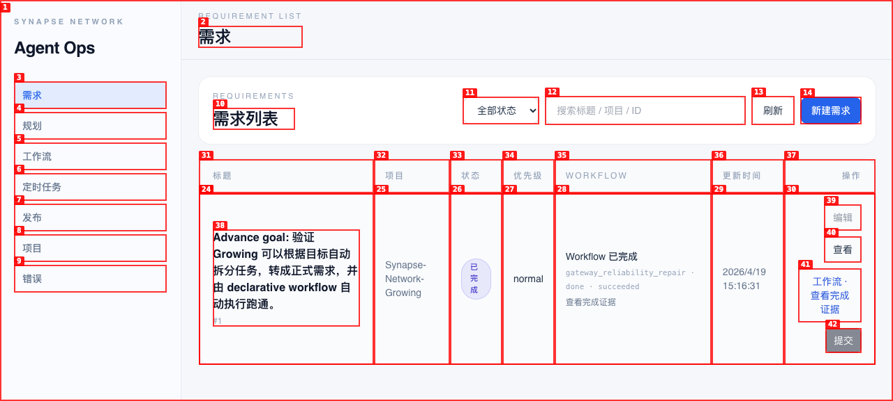
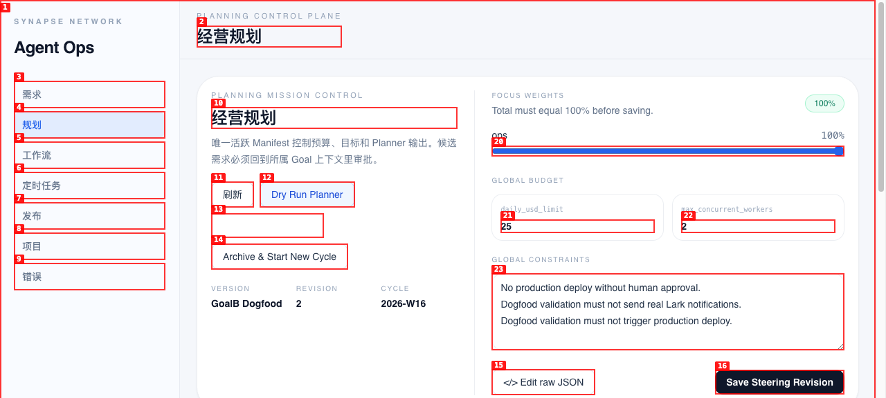
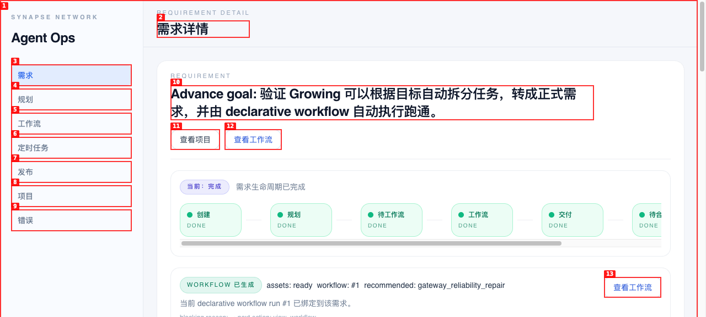
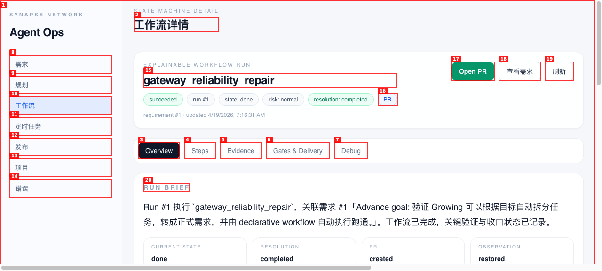
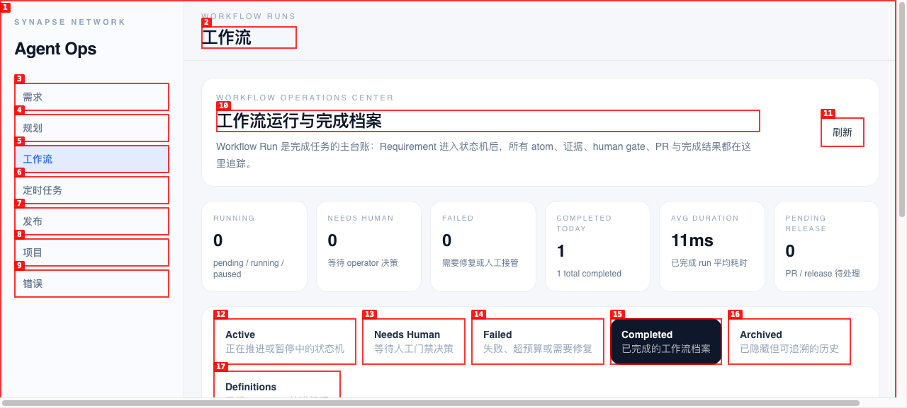
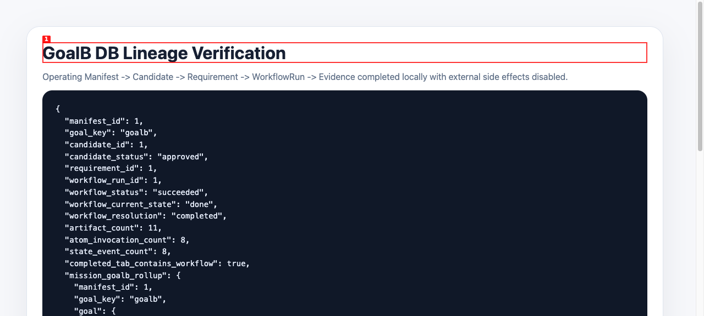

# Dogfood Report: Ops Console GoalB E2E

| Field | Value |
|-------|-------|
| **Date** | 2026-04-19 |
| **App URL** | http://localhost:9700/ |
| **Session** | ops-console-goalb |
| **Scope** | Validate page observability and GoalB end-to-end product flow |

## Environment

External side effects were disabled for this dogfood run.

```text
PYTEST_CURRENT_TEST=dogfood
OPS_LARK_DELIVERY_DRY_RUN=true
OPS_NOTIFICATION_DISPATCHER_ENABLED=false
```

The pre-existing local SQLite runtime DB still contained old destructive-cleanup columns. It was backed up to:

```text
dogfood-output/ops-console-goalb-20260419/db-backup/
```

The service was restarted so the local runtime DB could be recreated with the current schema.

## Summary

| Severity | Count |
|----------|-------|
| Critical | 0 |
| High | 0 |
| Medium | 0 |
| Low | 0 |
| **Total** | **0** |

## Verdict

`passed`

GoalB proved the current product design can run through:

```text
Operating Manifest
-> Planner Sweep
-> RequirementCandidate
-> Requirement
-> Declarative Workflow Run
-> Atom Invocations + Evidence
-> Completed Workflow archive
```

## Evidence

1. Requirement list shows the materialized GoalB requirement and completed workflow status.
   

2. Planning Console shows the `goalb` lane and a materialized requirement link.
   

3. Planning Console candidate area shows GoalB has moved out of pending action and into the requirement link state.
   

4. Requirement detail shows the materialized requirement and active workflow link.
   

5. Workflow detail shows `gateway_reliability_repair`, correctness, outcome, step rail, artifacts and PR evidence.
   

6. Workflow Operations Center `Completed` tab shows workflow run #1 with `goal: goalb`, `8 atoms`, `11 artifacts`, and no pending gate.
   

7. DB lineage summary confirms manifest, candidate, requirement, workflow, events, atoms and artifacts are connected.
   

## DB Lineage Summary

```json
{
  "manifest_id": 1,
  "goal_key": "goalb",
  "candidate_id": 1,
  "candidate_status": "approved",
  "requirement_id": 1,
  "workflow_run_id": 1,
  "workflow_status": "succeeded",
  "workflow_current_state": "done",
  "workflow_resolution": "completed",
  "artifact_count": 11,
  "atom_invocation_count": 8,
  "state_event_count": 8,
  "completed_tab_contains_workflow": true
}
```

Full machine-readable lineage:

```text
dogfood-output/ops-console-goalb-20260419/goalb-db-lineage.json
```

## Browser Console / Errors

No application errors were observed in the captured pages. Browser console contained only Vite dev-server connection and React DevTools informational messages.

## Notes

The screenshot named `03-goalb-candidate-approved.png` captures the post-materialization state. The candidate has already been approved and materialized, so the user-facing Planning lane correctly shows `Requirement #1` instead of an active approval button.
