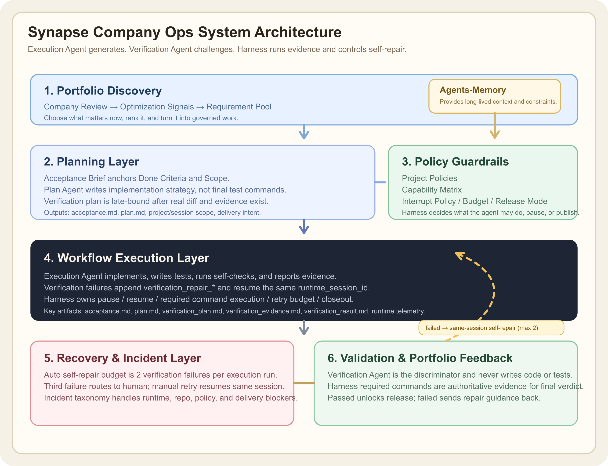
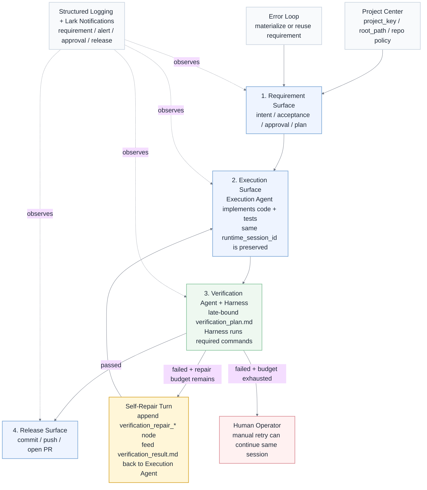

# Synapse Company Ops 最新架构设计

## 1. Summary

`Synapse-Network-Growing` 现在采用 **Agent-First 三面架构**，默认不再把系统建模成固定的 `research -> plan -> implementation -> validate -> closeout` 流程。

当前正式主线只有一条：

```text
Requirement -> Execution -> Release
```

当前正式拓扑图：





默认执行流也只保留最小核心形状：

```text
intake -> execute -> validate -> deliver
```

设计目标有 4 个：

1. 让 agent 主导执行内容与步骤展开。
2. 让程序只负责编排、验证、恢复和交付治理。
3. 把 requirement、execution、release 三种职责拆开，不再混在一个页面或一个状态机里。
4. 让简单任务默认走最短路径，复杂任务再按需展开。

补充的正式 UI 约束：

1. 控制台必须采用 Enterprise Workbench，而不是平铺卡片后台。
2. 视觉方向固定为克制型工程工作台，接近 Linear 风格，而不是营销化运营页。
3. Requirement / Execution / Release 三面必须各自有独立页面模板和信息密度策略。

## 2. Topology

### 2.1 Requirement Surface

Requirement 面只回答 3 个问题：

1. 为什么做
2. 要达到什么结果
3. 在什么约束下做

Requirement 保存的核心事实：

1. 标题与描述
2. 结构化 acceptance contract 与 markdown
3. execution plan
4. 所属 Project 与实际执行路径
5. priority / source / family
6. approval need / policy summary
7. 当前 requirement 状态

Requirement 现在默认先绑定正式 `Project`：

1. `Project` 提供 `project_key / display_name / root_path`
2. Requirement 创建默认先选项目
3. `target_project_path_override` 只作为高级覆盖字段存在
4. 项目级 GitHub、分支和部署配置不再散落在 requirement 自己身上

Requirement 到 Execution 的正式桥接规则：

1. `submit` 时就做 approval decision
2. 低风险 requirement 默认 auto-approve / waive
3. 审批放行后先确保 acceptance contract 与 execution plan 可用
4. execution plan 落库后自动创建 execution，并在目标项目上先准备 requirement branch，再自动启动 execution
5. 高风险 requirement 停在 requirement surface 等待人工批准
6. execution approval 只决定能否执行，不替代 release gate
7. acceptance contract 只定义完成标准；最终 verification plan 在 execution 完成后由 verification agent 基于真实执行证据晚绑定生成
8. requirement 只跟踪 active declarative workflow run；queued / blocked / awaiting_operator 的真实原因通过 workflow state、events 和 human gates 返回，而不是由前端猜测
9. 错误自修复采用统一 discovery pipeline，而不是让各错误入口各自决定 requirement 行为。
   - `/api/errors/intake`、`/api/bugs/intake/log-center`、`bug_log_sweep`
   - 先形成 `error_fingerprint / bug_record`
   - 再由 discovery recommendation + hard rules 决定是否 materialize requirement
10. approval 已收口为 `approval agent 先审，人兜底`。
   - agent 负责推荐 `approve / waive / revise / route_to_human`
   - policy 负责高风险硬边界
   - 人主要只处理高风险或低置信度 case
11. Declarative Workflow Factory 是新执行真相。
   - `workflow_runs.current_state` 表达当前状态
   - Blackboard 保存跨状态共享上下文
   - state events 与 atom invocations 保存可审计证据
12. 修复循环必须在同一个 workflow run 内通过 `patch -> verify` 等状态流转表达。
   - 不再创建独立 bugfix / delivery repair execution
   - 每个 loop 必须有 counter guard
   - 超预算进入 `awaiting_operator` 或失败终态

Requirement 面不再承担：

1. 执行节点控制
2. 运行时 telemetry 明细
3. PR / deploy / rollback 操作
4. 环境状态面板

### 2.2 Execution Surface

Execution 面是 agent 的工作面。

它负责：

1. execution mode
2. direct execute 或 execution graph
3. runtime backend / model / session
4. agent summary / changed files / command evidence
5. validate 结果
6. incident / self-repair / pause / resume / retry

Execution 面的默认策略：

1. 简单任务走单一 `execute`
2. 复杂任务才展开 execution graph
3. `verification agent` 永远是唯一正式质量门
4. verification 失败只允许进入同一个 Execution Agent session 的 `self-repair -> verification` 闭环

Execution 详情页当前正式暴露这些可观测性字段：

1. run 概览
   - `status`
   - `agent`
   - `runtime_backend / runtime_provider / runtime_model`
   - `current_branch`
   - `tokens_used_total`
   - `elapsed_ms`
2. node 级运行时明细
   - `task_id`
   - `task_status`
   - `agent`
   - `runtime_*`
   - `tokens_used`
   - `elapsed_ms`
3. 当前 run 改动文件
   - 只统计当前 execution 主链的文件改动
   - 支持 `diff` / 当前文件内容预览
4. verification 与 activity timeline
   - 当前 run 的 verification verdict、reasoning、evidence_used、suggested_next_action
   - `run_created / run_started / node_completed / verification_* / paused / resumed / retried`
5. execution detail 不直接堆原始日志，而是展示结构化 observability summary
6. execution detail 始终补充 agent 原始输出
   - 原始输出是正式证据层，不再只是缺失结构化字段时的临时 fallback

### 2.3 Release Surface

Release 面只负责交付与发布。

它负责：

1. release candidates
2. branch / commit / PR
3. delivery readiness
4. staging / production promotion
5. rollback
6. deployment history

Release candidate 的硬门槛：

1. requirement 已完成执行
2. verification agent 判定成功
3. verification passed 后已自动 commit / push / open PR，或至少留下明确的 release blocker
4. release governance 满足项目策略

### 2.4 Error Loop（辅助治理）

错误发现不再停留在独立日志系统里，而是进入正式主链：

```text
error event -> fingerprint -> requirement -> approval -> execution -> validate -> release
```

规则：

1. 只接高信号错误源：`runtime_log_error`、`task_failure`、`workflow_incident`
2. 同一 fingerprint 同时最多只能有一条未完成 requirement
3. 新错误 requirement 创建后立即 `submit`
4. 低风险自动审批、生成 plan 并自动启动 execution
5. 高风险 requirement 停在 requirement 面等待人工批准
6. `/errors` 只作为稳定性治理辅助页，不替代三大主面

### 2.5 Project Center

Project 现在是正式一等对象，不再把“项目”隐藏在 `target_project_path` 和 `project policy` 里。

它负责：

1. `project_key / display_name / root_path`
2. GitHub repo 与默认分支
3. deploy repo、deploy strategy、环境标签
4. 1:1 挂载的 `project policy`

固定关系：

1. `Project` 是主对象
2. `ProjectPolicy` 是治理子资源
3. Requirement 必须挂到 Project
4. Release / Deployment 必须从 Project 读取仓库和环境配置

### 2.6 Execution Observability Layer

Execution 现在除了“能跑”，还要求“可解释、可展示、可审计”。

正式观测面包括：

1. token 使用量
   - 每个 task / node 的 `tokens_used`
   - 当前 run 的 `tokens_used_total`
2. agent 与模型信息
   - `agent_id / agent_label`
   - `runtime_backend / runtime_provider / runtime_model`
3. 运行时长
   - node 与 run 都输出 `elapsed_ms`
4. branch 与交付上下文
   - branch 优先从当前 release / delivery 记录读取
5. changed files
   - 当前 execution run 实际改了哪些文件
   - 默认可预览 `diff`
6. activity timeline
   - 运行态事件时间线，而不是非结构化日志堆叠

固定原则：

1. Execution observability 只解释当前唯一 execution 主链
2. 不混入历史 run
3. 不做实时 git 探测来拼展示字段
4. token 真源固定为 task 记录中的 `tokens_used`

### 2.6.5 Planning Lifecycle Control Plane

当前系统补齐了需求发现上游：[Planning Lifecycle Operating Manifest](planning-lifecycle-operating-manifest.md)。

核心模型：

1. `OperatingManifest` 是唯一 active 的公司策略快照。
2. `goals[]` 定义当前目标、权重、成功指标和约束。
3. `Planner Sweep` 是无状态评估器，只读取 active manifest 与聚合进度，生成 `RequirementCandidate`。
4. `RequirementCandidate` 是自动规划与正式 requirement pool 之间的缓冲区。
5. `goal_key` 穿透 candidate、requirement、workflow run 和 release record，形成全生命周期 rollup。

关键边界：

1. Archived Manifest 历史通过分页和搜索展示全部，不截断到最近 12 个周期。
2. Drop Goal 只停止未来投入并安全阻断未交付链路。
3. Drop Goal 会 suppress candidates、cancel 未开始 requirements、pause running workflows、block 未发布 release-ready 记录。
4. Drop Goal 绝不自动 rollback、revert commit 或删除已发布产物。
5. 下线已发布功能必须创建新的 decommission requirement，并走正常 workflow / verification / human gate / release。

### 2.7 Declarative Workflow Factory

当前默认执行流仍保持最小核心形状：

```text
intake -> execute -> validate -> deliver
```

复杂工作流不再回到硬编码多阶段 Python，也不让多个 Agent 自由开会决定控制流。正式执行主链切换为 [Declarative Agent Workflow Factory](declarative-agent-workflow-factory.md)：

1. workflow 用 State Machine YAML 表达，而不是单向 DAG 或 Python `if-else`。
2. 每个 workflow run 共享 Blackboard，避免 diagnose、patch、verify 之间上下文撕裂。
3. Agent Atom 负责诊断、生成、修复、文案和支持理解等认知任务。
4. Deterministic Atom 负责日志读取、命令执行、schema 校验、artifact 写入、PR 创建和风险门禁。
5. State transition 只能由 deterministic runner 根据 evidence、schema、budget 和 policy 决定。
6. 高风险 atom 永远进入 human gate；资金、结算、合约、auth、生产和外部付费动作不自动放行。
7. 新执行真相是 `workflow_runs.current_state + blackboard + workflow_state_events + atom_invocations`，不再使用 fixed `workflow_steps` 作为主执行形状。
8. 第一批正式 workflow 是 `agent_self_repair` 与 `gateway_reliability_repair`；前者验证系统自修复但只能 PR-only + human approval，后者验证真实产品 reliability loop + observing。

这使系统可以从 human intent / desired state 生成新工作流，同时继续保持当前 Company Ops 的可审计性和安全边界。

前端控制台需要把这套链路表达成 Operator 能直接理解的 Control Plane，而不是继续停留在表格和调试 JSON。整体页面方案见 [Workflow Factory Frontend Control Plane](workflow-factory-frontend-control-plane.md)：它定义 Command Center、Intake、Requirements、Workflows、Human Gates、Projects、Releases 和 Data Hygiene 的边界，并明确 Projects / Errors 在新架构中仍然保留但要降噪重组。

### 2.8 Scheduled Jobs Control Plane

后台自动化不能只藏在线程、日志或请求副作用里。当前系统新增 [Recurring Workflow Control Plane](recurring-workflow-control-plane.md)，把真实自动运行和可手动触发的 recurring workflows 作为一等可观测对象。

当前边界：

1. `/schedules` 展示内置 recurring workflow registry、运行历史、健康状态和手动 dry run / run now。
2. Bug Log Sweep Scheduler 是真实自动定时运行的稳定性入口，负责日志扫描和 bug intake。
3. Notification Dispatcher 是真实后台 loop，负责通知队列消费、dedupe、cooldown、suppression、retry 和 dead letter。
4. 其他 recurring workflows 先作为可手动运行的一等任务定义，不由通用 scheduler 自动运行。
5. 高风险 recurring workflow 的 `Run Now` 默认不 auto-start requirement，也不能绕过 human gate。

这让 operator 能看到“谁在后台推动系统、上次跑了什么、失败在哪里、是否卡住”，避免后台任务变成新的黑盒。

## 3. Core Execution Model

### 3.1 Planner Contract

planner 现在是 **执行形状选择器**，不是固定阶段生成器。

当前 requirement 主链中还有两份独立但协同的 agent 产物：

1. acceptance contract
   - 回答“什么算完成、怎么验证完成”
2. execution plan
   - 回答“准备怎么做、改哪里、怎么交付”

固定规则：

1. requirement 创建后先保存记录，并在后台生成 acceptance contract 与 execution plan
2. requirement `submit` 放行前会确保这两份产物可用
3. execution 完成后自动派发 verification agent
4. verification agent 默认读取 acceptance contract 的完成标准、范围约束、execution plan、changed files、raw output 与 execution evidence
5. verification agent 先生成晚绑定 `verification_plan.md`；Harness 执行其中 required commands 并记录权威 evidence 后，verification agent 再产出正式 verdict
6. execution detail 同时展示 plan、observability、verification plan、Harness evidence、verification result 与 raw output

它只做一次轻量决策：

1. `execution_mode`
   - `direct`
   - `graph`
   - `deterministic`
2. `complexity`
   - `simple`
   - `standard`
   - `complex`
3. `validation_profile`
4. `delivery_intent`
5. `approval_required`
6. `target_projects`

默认规则：

1. 简单任务直接进入单步 `execute`
2. 多仓或长链路任务才生成 execution graph
3. planner 不再产出固定 research/plan/closeout 仪式步骤

### 3.2 Minimal Artifact Set

当前只保留最小证据集：

1. `requirement_brief`
2. `execution_record`
3. `validation_record`
4. `delivery_record`

可选扩展 artifacts 只在特定场景出现：

1. `bug_report`
2. `incident_record`
3. `context_compaction`
4. `approval_record`

原则：

1. 没有消费方的 artifact 不生成
2. artifact 必须服务于 Requirement、Execution、Release 其中一面
3. 禁止为阶段完整性制造仪式性产物

### 3.3 Execution Lifecycle

Execution 现在采用严格的单主链模型：

1. 同一 requirement 同时只允许一条当前 execution 主链
2. `queued / running / paused / validating` 才算当前活跃 execution
3. 已完成、已失败、已验证的 run 不能再次 `start`
4. verification failure 不创建 replacement run，而是在当前 run 追加 `verification_repair_*` 节点并复用同一个 Execution Agent session
5. requirement、execution、release 三面都只按当前唯一主链解释
6. `retry` 仍用于 task failure、环境阻塞恢复或 operator 手动继续；self-repair 预算耗尽后的 operator retry 也复用当前 session
7. 旧脏 execution / release 运行态数据不做兼容，直接通过重置脚本删除

### 3.4 Runtime Governance

程序保留的 deterministic 职责只有：

1. 项目边界与 project policy
2. approval / permission / interrupt policy
3. runtime lifecycle
4. validate 守门
5. delivery / release 记录
6. incident / recovery / self-repair loop

程序不再负责：

1. 固定执行阶段数
2. 强制先 research 再 plan
3. 强制输出长篇结构化计划
4. 用阶段名驱动 artifact 生成

Self-repair 现在由 [Declarative Agent Workflow Factory](declarative-agent-workflow-factory.md) 中的 state machine loop、blackboard 与 retry budget 统一表达。

### 3.5 Logging Layer

Python 服务的日志层现在采用统一约束，而不是各自随意输出文本日志。

固定标准：

1. `structlog` 负责结构化事件与上下文绑定。
2. 标准库 `logging` 负责 handler、级别和轮转。
3. 主输出是 `stdout` JSON，供容器、采集器和告警链路直接消费。
4. 本地文件日志只做备份，格式为 `JSONL`，按天切分并默认保留 14 天。
5. 当前阶段按“各服务内实现、同一规范”落地，不假设已有共享 Python logging 包。

统一字段契约：

1. 基础字段：`ts`、`level`、`event`、`service`、`env`、`logger`、`message`
2. 主链字段：`request_id`、`task_id`、`requirement_id`、`execution_id`、`release_id`、`fingerprint_key`
3. 结果字段：`outcome`、`status`、`duration_ms`、`error_type`、`error_message`

统一事件分层：

1. `audit`
   requirement created、approval decided、execution started、release pr opened
2. `runtime`
   http request、task runtime、scheduler、external call、timed operation
3. `error`
   runtime failure、validation failure、workflow incident、bug intake

日志在三面架构中的职责：

1. Requirement 面依赖结构化日志记录创建、审批和 submit 桥接，不依赖自由文本解析。
2. Execution 面依赖结构化日志串起 runtime backend、command evidence、validate 和 retry。
3. Release 面依赖结构化日志记录 prepare branch、open PR、deploy、rollback。
4. Error Loop 依赖结构化字段而不是原始文本尾行做指纹、告警和 requirement 回流。
5. Lark requirement / alert / approval / release 通知应直接消费结构化日志字段，不依赖非结构化 message 解析。

## 4. Data Model

当前一等对象分为三组：

### 4.1 Requirement

1. `requirements`
2. requirement 只记录业务意图、约束与治理字段

### 4.2 Workflow Execution

1. `workflow_definitions`
2. `workflow_runs`
3. `workflow_state_events`
4. `workflow_artifacts`
5. `blackboard_snapshots`
6. `atom_invocations`
7. `human_gate_requests`
8. `validation_records`
9. `incidents`

### 4.3 Release

1. `release_records`
2. `deployment_records`

### 4.4 Project

1. `projects`
2. `project_policies`

这意味着旧的 fixed-step execution / task / workflow_step 语义已经退出正式主线，不再作为当前架构的中心对象；同时 `target_project_path` 也不再是用户侧项目管理的主入口。

## 5. Product Surface

当前控制台正式导航保留三面主链，并新增项目中心：

1. `/requirements`
2. `/workflows`
3. `/releases`
4. `/projects`

页面职责：

1. `/requirements`
   requirement 列表、创建、编辑、提交、取消
2. `/requirements/:id`
   requirement 意图、验收与顶部执行/发布动作
3. `/workflows`
   declarative workflow run 列表与当前状态机主链入口
4. `/workflows/:id`
   state timeline、Blackboard、atom invocations、artifacts、human gates、retry counters
5. `/releases`
   release candidate 列表
6. `/releases/:requirementId`
   prepare branch、open PR、deploy、rollback、deployment history
7. `/projects`
   项目列表、GitHub 配置、部署配置、治理配置
8. `/projects/:id`
   单个项目的基础信息、交付配置与 policy

辅助治理页：

1. `/errors`
2. `/errors/:fingerprintKey`

它们只承担错误聚合、关联 requirement/execution 和通知历史展示。

### 5.3 功能清单

当前正式功能范围以这份清单为准，并要求后续迭代同步更新：

`docs/design-docs/current-feature-inventory.md`

### 5.1 Runtime Reset

当前不兼容旧脏 execution 数据。需要重置运行态时，使用：

```bash
/Users/cliff/workspace/agent/.venv/bin/python /Users/cliff/workspace/agent/Synapse-Network-Growing/scripts/reset_execution_runtime.py --yes
```

该命令会清空 declarative runtime：

1. `workflow_runs`
2. `workflow_state_events`
3. `workflow_artifacts`
4. `blackboard_snapshots`
5. `atom_invocations`
6. `human_gate_requests`
7. `validation_records`
8. `release_records`

并把 requirement 状态重置回可重新推导的基线。

### 5.2 Frontend Surface Anatomy

当前页面骨架必须遵守下面的简洁 SaaS 结构：

1. `shell`
   负责全局导航、环境感和页面边界。
2. `page header`
   负责页面定位、主说明和单页 focus strip。
3. `primary workspace`
   负责主要工作对象：
   - requirement intent
   - execution evidence / graph
   - release timeline
4. `secondary actions`
   负责筛选、搜索、确认弹窗和轻量反馈。
5. `context areas`
   只在确实需要时展示 incidents、deployment records 和系统轨迹。

禁止的工作台模式：

1. 同权重大白卡瀑布流
2. 每个 section 都用圆角白卡包裹
3. 依赖 chips/pills 代替真正的信息层级
4. Requirement 页面重新混入 deploy / rollback 控制

不再作为当前正式主入口的页面：

1. 运营总览首页
2. company review
3. role kpis
4. autonomy
5. recurring workflows 旧式控制台
6. tasks / approvals / deployments 旧式控制台

这些能力如果仍保留为内部支撑或历史设计记录，也不再代表当前正式操作面。

## 6. System Guardrails

当前架构必须遵守这些硬约束：

1. 默认 workflow 必须最小化
2. simple task 不得被治理框架强制扩成多步
3. Requirement / Execution / Release 必须分面治理
4. planner 是形状选择器，不是阶段生成器
5. validate 必须独立于 execute
6. deliver 只能发生在 validate 成功之后
7. release candidate 只接受 validate 成功的 requirement
8. requirement、alert、approval、release 四类 Lark 通知必须统一走结构化交互卡片；alert 只放 P0/P1，approval 只放 human gate，普通 workflow 细节留在 Ops Console。
9. 后台 scheduler、dispatcher 和 recurring workflow 必须通过 `/schedules` 暴露健康、运行历史、手动 dry run 和失败信息，不能只藏在 daemon 日志里。

## 7. Current Status

当前代码已经采用以下实现方向：

1. requirements、workflows、releases 已拆成独立 API surface
2. 前端导航已切成需求、工作流、定时任务、发布、项目、错误
3. requirement 页面不再混入 deploy / rollback 控制
4. release 页面负责 branch / PR / deploy promotion
5. optimization signals、company review、requirement source materialization 已改用新的 requirement intake 入口

后续新增能力默认必须接入这条三面主线，而不是把旧的固定 step workflow 再引回来。
