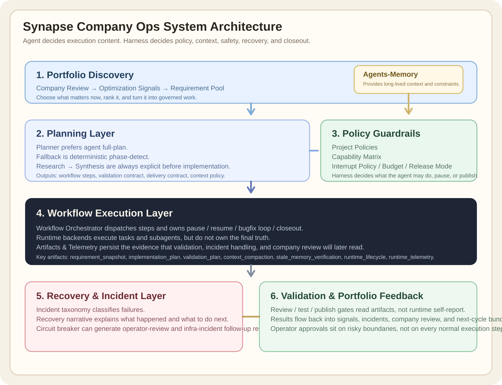
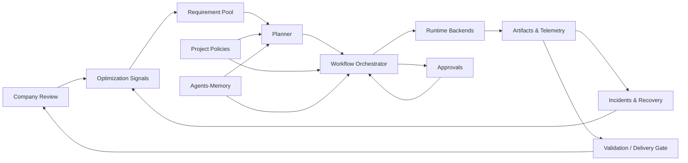
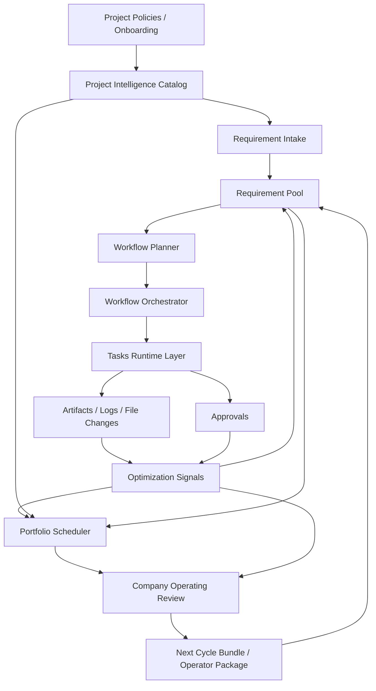

# Synapse Company Ops 最新架构设计

## 1. 目标

`Synapse-Network-Growing` 现在不是单一 dashboard，而是整个 Synapse 体系的公司级编排中枢。

它的职责是把这几层接起来：

1. 公司级 review 与 portfolio 决策
2. optimization signal 发现与转 requirement
3. requirement-first workflow orchestration
4. task runtime 与 approval 治理
5. project policy / onboarding / budget / rebalance
6. 结果回流到 signal、company review 和下一周期 bundle

## 1.0 Runtime Backend Matrix

当前系统已经不再把 planner 和 execution runtime 硬绑在单一供应商上，而是按 `ORCHESTRATION_BACKEND` 选择实际运行路径。

当前支持的 backend 有：

1. `legacy`
2. `openai_responses`
3. `copilot_sdk`
4. `codex_cli`

### planner / runtime 对齐规则

现在 planner 的 `full-plan` 不再固定依赖 Copilot。

统一规则是：

1. `ORCHESTRATION_BACKEND=openai_responses`
   planner provider = `openai`
2. `ORCHESTRATION_BACKEND=copilot_sdk`
   planner provider = `copilot`
3. `ORCHESTRATION_BACKEND=codex_cli`
   planner provider = `codex`
4. 没显式指定 backend 时，才回退看 `LLM_PROVIDER`

这样做的目的，是避免“任务执行已经切到一种 runtime，但 planner 还在调用另一种模型”的错配。

### codex_cli backend

`codex_cli` 的定位是：

1. 使用本机 `codex exec`
2. 复用本地 Codex / ChatGPT 登录态
3. 同时服务 planner full-plan 和 workflow step execution

当前行为：

1. planner full-plan 会通过 `CodexCLIProvider` 调 `codex exec`
2. task runtime 会通过 `CodexCLITaskRuntime` 调 `codex exec`
3. task 执行会把 `cwd / add_dirs / command / exit_code / stderr` 写入 `metadata.json`
4. 这是同步 backend，不依赖 detached monitor

推荐配置键：

1. `ORCHESTRATION_BACKEND=codex_cli`
2. `LLM_PROVIDER=codex`
3. `LLM_MODEL=gpt-5-codex`
4. `CODEX_CLI_MODEL=gpt-5-codex`
5. `CODEX_CLI_FULL_AUTO=true|false`
6. `CODEX_CLI_SANDBOX=workspace-write|danger-full-access|read-only`

它的价值不是“替代所有 API backend”，而是给 portfolio 一个不依赖 API billing 的本机执行路径。

## 1.1 设计原则边界

系统级硬约束已沉淀到：

1. `/Users/cliff/workspace/agent/Synapse-Network-Growing/docs/design-docs/system-design-principles.md`

后续所有设计与实现默认必须满足这些原则，尤其是：

1. 把模型当不稳定部件，不当同事
2. 错误路径按主路径设计
3. verification 独立于 implementation
4. 多代理用于隔离不确定性
5. runtime / subagent 必须有生命周期与 cleanup
6. 上下文必须按 budget / compact / stale verify 治理

## 1.1A Requirement → Plan → Execution 的边界

当前系统采用的边界是：

1. requirement 定义目标、约束、目标项目与验收意图
2. planner 模型决定具体改哪些项目、改代码还是改文档、如何拆 implementation 子步骤
3. harness 只负责限制项目边界、能力边界、interrupt policy、验证流程和交付治理

这意味着：

1. 不再由 harness 预判 `docs-only` 或强制指定主仓
2. 不再由 harness 预判“这次必须先 frontend 后 backend”
3. 模型可以在目标项目范围内自由决定 docs/code/mixed change shape
4. validation 会根据实际变更到的项目动态收集 `project_change_summary`，再进入 review/test/closeout

## 1.1B Requirement Approval Contract

acceptance contract 负责“做完后谁来验收”，requirement approval contract 负责“开始前谁来放行”。

当前 requirement 级审批状态定义为：

1. `pending_approval`
2. `approved`
3. `rejected`
4. `waived`

边界约束：

1. `approval_status` 决定 requirement 能不能进入自动执行
2. `workflow status` 只表达执行进度，不再混用成审批状态
3. step 级 `operator_confirmation` 仍保留，但它只约束单个 step，不替代 requirement 级审批

当前 approval contract 默认字段为：

1. `approval_mode`
   1. `auto_or_human`
   2. `manual_required`
   3. `waived`
2. `required_approver_roles`
3. `fallback_reviewer`
4. `auto_approve`
   1. `max_priority`
   2. `max_complexity_tier`
   3. `single_project_only`
   4. `allow_incident_recovery`

实际行为：

1. requirement 创建后默认先进入 `pending_approval`
2. `plan` 会根据 planner 产出的 complexity tier、目标项目数量、incident 属性尝试 auto-approve
3. 自动审批失败时会生成 `requirement_execution_approval`
4. `scheduler` 只调度 `approved / waived`
5. `start` 会再次检查 approval status，未审批不能进入自动执行
6. 人工审批后 requirement 才会真正开始自动执行

## 1.2 新增的执行约束层

现在 `project policy` 不再只负责路径和发布模式，还负责显式执行约束。

每个项目策略现在都包含两组控制面：

1. `capability_matrix`
2. `interrupt_policy`

### capability matrix

当前统一字段为：

1. `shell_access`
2. `git_read`
3. `git_write`
4. `git_push`
5. `network_access`
6. `publish`

它们的作用不是“给 UI 展示一下”，而是直接进入：

1. planner output
2. workflow step `approval_policy`
3. delivery contract 的 `auto_publish_allowed`
4. step dispatch 前的 policy interrupt

### interrupt policy

当前统一字段为：

1. `operator_confirmation_actions`
2. `auto_pause_on_events`
3. `auto_abort_on_events`

它定义了：

1. 哪些动作必须转 operator confirmation
2. 哪些事件要把 workflow 自动暂停
3. 哪些事件要直接终止并转入 revision / incident 路径

### 当前已接入的行为

当前系统已经做到：

1. planner 会把 capability/interrupt 约束写入每个 workflow step
2. step prompt 会显式展示 capability contract，而不是让 agent 猜
3. 如果某个 step 所需能力被 policy 禁用，dispatch 前会生成 `capability_interrupt` artifact
4. 触发 `capability_denied` 时，workflow 会按 interrupt policy 自动 `pause / block`
5. delivery contract 的 auto publish 只会在 `git_push + publish` 都允许、且不要求 operator confirmation 时开启

## 1.3 新增的上下文治理层

在 capability / interrupt 之后，当前系统又新增了一层显式的 context governance。

这一层的目标不是“让 prompt 更漂亮”，而是约束：

1. 每个 workflow step 最多能看到多少上下文
2. 什么时候必须 compact
3. 哪些 artifact 需要做 stale verify
4. 发现陈旧上下文时是否阻断 dispatch

### step-level context policy

现在 planner 会为每个 step 输出独立的 `context_policy`，当前统一字段为：

1. `max_prompt_chars`
2. `compact_after_chars`
3. `max_artifact_body_chars`
4. `max_handoff_chars`
5. `stale_after_minutes`
6. `stale_sensitive_artifact_types`
7. `block_on_stale_memory`

这些策略会持久化到 `workflow_steps.context_policy_json`，不再依赖隐式默认行为。

### deterministic compaction

dispatch 前，orchestrator 会按固定顺序构造 step context：

1. requirement summary
2. target project + project policy summary
3. capability contract
4. done_when
5. predecessor handoff
6. bound artifacts

如果上下文超过预算：

1. 先按 handoff / artifact 的上限截断
2. 再生成结构化 compact 结果
3. 仍超限时再收敛到 `max_prompt_chars`

整个过程会生成 `context_compaction` artifact，记录：

1. `raw_chars`
2. `final_chars`
3. `compacted`
4. `binding_summaries`
5. `section_summaries`

dispatch 前还会生成 `prompt_cache_profile` artifact，记录：

1. `cache_key`
2. `reusable_sections`
3. `reusable_section_count / reusable_artifact_count`
4. `deduped_binding_count`
5. `cached_chars_saved`

也就是说，现在系统会先把稳定的 project / capability / done_when / contract artifact 收成可复用摘要，再把重复 binding 去掉，最后才进入 hard compaction。

### stale memory verification

dispatch 前还会生成 `stale_memory_verification` artifact。

当前会重点检查：

1. 关键 artifact 是否属于当前 workflow run
2. stale-sensitive artifact 是否超过允许时间窗口
3. requirement 是否在 workflow 创建后发生了需要重新审视的大幅更新

如果当前 step 的 policy 指定 `block_on_stale_memory = true` 且验证结果不是 `fresh`，系统会：

1. 阻断该 step dispatch
2. 创建或复用 `stale_memory_review` approval
3. 将 workflow 暂停
4. 将 requirement 标为 `blocked`

### UI 与 operator 可见性

`/requirements/:id` 详情页现在新增了 `Context Governance` 面板，可直接查看：

1. 当前 step 的 context policy
2. 最近一次 compaction 结果
3. 最近一次 stale memory verification 状态

这样 operator 不再需要靠猜测判断“agent 到底看到了什么上下文”。

## 1.4 新增的 runtime lifecycle / telemetry 层

在 context governance 之后，当前 requirement workflow 又新增了一层运行期治理。

目标是把 runtime / subagent 的生命周期从“散落在 task logs 和 monitor 里”提升成可复盘的 workflow artifact。

### 当前新增的 artifact

现在每个进入 dispatch 的 workflow step，都会开始产出两类 artifact：

1. `runtime_lifecycle`
2. `runtime_telemetry`

### runtime_lifecycle

用于记录 step 对应 runtime 的状态切换，当前已覆盖：

1. `dispatch_requested`
2. `running`
3. `waiting_approval`
4. `completed`
5. `failed`
6. `paused`

artifact payload 会记录：

1. `runtime_backend`
2. `runtime_session_id`
3. `runtime_selected_agent`
4. `task_status`
5. `step_status`
6. `skill_name`
7. `started_at / completed_at`
8. `last_error_message`

### runtime_telemetry

用于汇总运行期证据，当前会聚合：

1. `task_logs` 中的 runtime/subagent/tool/permission/user_input 事件
2. subagent 的 selected / started / completed / failed 计数
3. runtime session state snapshot
4. transcript 是否已经产生

这样 requirement 详情页、incident 分析、optimization signal 都可以读同一份结构化 telemetry，而不必各自重新解析日志。

### 运行期状态来源

当前这层治理使用三类来源：

1. `TaskRow` 上的 backend / session / selected_agent / status
2. `TaskLogRow` 中的 runtime / subagent 事件
3. Copilot SDK detached runtime 的 state file

其中：

1. task runner 负责写原始 task log
2. monitor 负责持续同步 detached runtime state
3. workflow orchestrator 负责把它们归档成 requirement-level artifact

### UI 与 operator 可见性

`/requirements/:id` 详情页现在新增了 `Runtime Lifecycle` 面板，可查看：

1. 最新 lifecycle snapshot
2. telemetry summary
3. recent runtime events
4. subagent 计数

这一步的意义是：operator 终于能直接回答“这个 requirement 现在到底卡在 runtime 的哪一层”，而不是同时翻 task logs、session state 和 workflow 状态。

## 1.5 新增的 incident taxonomy / recovery narrative 层

在 runtime telemetry 之后，当前系统又补上了一层统一的 incident view。

这层的目标是：

1. 把分散的 failure artifact 统一归类
2. 为 operator 生成可执行的 recovery narrative
3. 让 requirement detail 和 optimization signals 读同一套事故视图

### 当前统一接入的 incident 来源

当前 incident taxonomy 会归一这些 artifact：

1. `bug_report`
2. `capability_interrupt`
3. `stale_memory_verification`
4. `bugfix_circuit_breaker`
5. `runtime_lifecycle`

### incident record 的统一字段

每个 incident 至少包含：

1. `incident_family`
2. `incident_code`
3. `severity`
4. `recovery_status`
5. `summary`
6. `recommended_action`
7. `source_artifact_type`

## 1.6 系统交互图

下面这张图描述当前系统主链路，以及 agent 决策和 deterministic harness 分工边界。





### 交互含义

1. `company review` 负责 portfolio 级观察、incident 汇总和下一周期 recommendation。
2. `optimization signals` 把 incident、bug report、delivery blocker、manual override 聚合成可治理对象。
3. `requirement pool` 是正式 intake 层，只有进入 requirement 的工作才会进入可追踪 workflow。
4. `planner` 先做 plan，再把 project policy、routing、context governance、delivery contract 一起写进执行结构。
5. `workflow orchestrator` 负责 step dispatch、pause/resume、bugfix loop、interrupt policy、incident follow-up。
6. `runtime backend` 只负责执行，不拥有最终控制权；最终控制仍在 orchestrator 和 policy。
7. `artifacts` 是统一事实层，validation、incident、company review 都从这里回读，不直接相信 runtime 自述。

## 1.7 当前 plan 是怎么生成的

当前 planner 已经是“尽可能让 agent 决策，但不给 agent 无限权力”的结构。

这里的 `planning_mode` 指的是服务端 `workflow_planner.py` 的规划模式，不是 Codex 客户端或聊天工具里的 `/plan` UI 模式。

### 默认路径

默认优先走 `full_plan`：

1. planner 调用 agent 一次性产出结构化 step JSON
2. agent 决定 step 列表、step key、scope、依赖、done_when
3. 系统再把这些 step 注入 project policy、capability matrix、context policy、validation gate

也就是说：

1. step 形状尽量由 agent 决定
2. 执行边界和风险控制由 harness 决定

### 回退路径

如果 agent 不能稳定返回结构化 step JSON，就回退到 `phase_detect`：

1. 先保留 `research`
2. 再保留 `synthesis`
3. 再根据 requirement 文本确定是否需要 `design / frontend_impl / backend_impl / test_impl`
4. 最后固定进入 `review -> test -> closeout`

这条路径是 deterministic fallback，不依赖 agent 的结构化 JSON 质量。

### 为什么 step 看起来会重复

旧版本里，fallback step 的标题会把整条 requirement 标题重复拼到每一步，导致：

1. UI 很啰嗦
2. token 浪费
3. 同类 step 之间辨识度反而变差

当前已收敛为短标题：

1. `Research context`
2. `Synthesize plan`
3. `Design architecture`
4. `Frontend implementation`
5. `Backend implementation`
6. `Test implementation`
7. `Review output`
8. `Validate output`
9. `Close requirement`

requirement 标题保留在 workflow 顶层，不再在每个 step title 里重复灌输。

## 1.8 让 agent 决策，但不让 agent失控

当前系统的分工原则是：

### 让 agent 决策的部分

1. full-plan 模式下的 step 设计
2. research 阶段的信息搜集与方案空间探索
3. synthesis 阶段的执行方案压缩
4. implementation 阶段的具体代码改动和执行路径
5. review/test 阶段的具体验证产物内容

### 必须由 harness 决定的部分

1. 目标项目是否受管、是否可写
2. capability matrix 是否允许 shell / git / publish
3. interrupt policy 何时 pause / abort / operator confirm
4. context budget、compact、stale verify
5. approval gate、delivery gate、publish gate
6. circuit breaker、incident taxonomy、recovery follow-up

也就是说，系统追求的是：

1. `agent 决策执行内容`
2. `harness 决策边界、治理和回收`

而不是把整个系统的控制权交给 agent。

## 1.9 evidence 去重策略

optimization signal 的 evidence 现在按“保留 occurrence_count、压缩重复 evidence”处理。

具体规则是：

1. `occurrence_count` 保留原始出现次数，继续用于排序和 signal score。
2. `evidence` 只保留去重后的代表样本，避免相同错误反复灌进上下文。
3. 去重不是按 artifact id，而是按错误语义去重，例如：
   1. bug report：`step_type + failed_checks + content_summary`
   2. delivery blocker：`blocker + publish_status`
   3. workflow incident：`incident_code + recovery_status + summary`

这样可以同时满足：

1. 信号强度不丢
2. token 不被重复 evidence 吃掉
3. operator 还能看见代表性样本
8. `source_artifact_id`

### 当前 taxonomy family

目前系统已经覆盖这些 family：

1. `verification`
2. `governance`
3. `context_integrity`
4. `recovery_loop`
5. `runtime_orchestration`

### requirement detail 如何使用它

`/requirements/:id` 现在新增了 `Recovery Narrative & Incidents` 面板。

operator 可以直接看到：

1. 当前 requirement 最近的重要 incident
2. 事故属于哪一类 taxonomy
3. 当前 recovery status 是什么
4. 推荐动作是什么

### optimization signals 如何使用它

optimization signal 现在除了原来的：

1. `bug_report`
2. `delivery_blocker`
3. `manual_override`

还会生成：

1. `workflow_incident`

这类 signal 会直接附带：

1. `incident_family`
2. `incident_code`
3. `recovery_status`
4. `recovery_narrative`

因此 signal 不再只是“有问题”，而是会明确告诉 operator“这是哪类事故，以及建议怎样收口”。

## 2. 当前推荐的数据库策略

## 1.10 模型分层与预算治理

为了同时保证任务完成率和 token 效率，当前推荐把模型路由收成下面这条主线：

1. `harness` 固定流程，不固定内容。
2. `planner` 负责把 requirement 展开成 step graph，并给每个 step 标注复杂度、预算和升级规则。
3. `scheduler` 根据复杂度、项目风险、预算余量和历史失败率选择实际 runtime/model tier。
4. `orchestrator` 执行时可以按失败信号自动升级或降级，不需要人工每次介入。
5. `review/test` 根据实际变更到的项目动态决定验证重点，而不是提前写死“这次一定只跑某个仓库的验证”。

### planner 输出建议

建议 planner 后续稳定产出以下字段：

1. `complexity_tier`
   1. `mini`: 搜索、分类、摘要、日志归因、测试结果整理
   2. `standard`: synthesis、常规实现、review、测试修复
   3. `max`: 跨仓重构、疑难 bug、架构迁移、反复失败后的升级处理
2. `budget_cap`
   1. 限制该 step 最大可消耗的模型预算
3. `escalation_rule`
   1. 失败 2 次升级
   2. 多项目升级
   3. 改动文件过多升级
   4. review/test 发现 blocker 升级
4. `expected_outputs`
   1. 该 step 应产出的摘要、补丁、测试报告、验证证据
5. `allow_escalation`
   1. 是否允许 orchestrator 自动把该 step 提升到更强模型

### runtime 路由建议

当前推荐用双层 runtime：

1. `openai_responses`
   1. 负责便宜的 planning、signal summarization、incident clustering、company review aggregation
2. `codex_cli`
   1. 负责真正要读仓、改仓、跑命令的 `implementation / review / test`

这样做的原因是：

1. planning 与聚合类工作对终端/文件系统依赖弱，更适合便宜模型
2. implementation/review/test 需要真实仓库上下文和命令执行，更适合 codex runtime
3. 不把所有任务都扔给最贵模型，可以明显降低高频 orchestration 的成本

### 动态验证建议

validation 不应在 requirement 创建时一次性写死，而应在执行后按真实修改结果动态生成：

1. implementation 结束后生成 `project_change_summary`
2. review/test 读取 `project_change_summary`
3. 只对真实改到的项目收集 policy、required checks 和验证命令
4. closeout 根据实际执行过的验证结果决定是否允许关闭或发布

这能避免两个问题：

### 当前已实现

当前系统已经落地了这一阶段的核心能力：

1. `P0-R1 Planner Tier Annotation`
   1. planner 在 `full-plan` 和 fallback 两条路径都稳定输出 `complexity_tier / budget_cap / allow_escalation / escalation_rule / expected_outputs`
   2. `workflow_steps.execution_profile_json` 会持久化这些标注
   3. requirement detail 已展示 step tier 与 budget cap
2. `P0-R2 Runtime Selection Contract`
   1. task dispatch 前会读取 step 的 `execution_profile`
   2. runtime selection 会显式选择 `backend / provider / model`
   3. 任务与 runtime telemetry 已记录 `runtime_backend / runtime_provider / runtime_model`
   4. 支持按 tier 做配置覆盖：
      1. `OPS_RUNTIME_TIER_MINI_BACKEND / PROVIDER / MODEL`
      2. `OPS_RUNTIME_TIER_STANDARD_BACKEND / PROVIDER / MODEL`
      3. `OPS_RUNTIME_TIER_MAX_BACKEND / PROVIDER / MODEL`
3. `P0-R3 Dynamic Validation Contract`
   1. implementation / bugfix 完成后会读取最新 `project_change_summary`
   2. `validation_plan` 会动态写入 `affected_projects / dynamic_required_checks`
   3. `delivery_contract.required_checks` 会改成“只针对真实改动项目”的检查集合
   4. 新的 validation/delivery contract 会重新绑定到后续 workflow steps，因此 review/test/closeout 读取到的是最新验证范围
4. `P1-R1 Escalation And Downgrade Loop`
   1. dispatch 前会按 `project_change_summary` 自动触发 tier escalation：
      1. 多项目改动升级
      2. changed files 超阈值升级
   2. 失败路径会把 `failure_count` 写回 step execution profile，并在 follow-up bugfix/review/test 上自动应用 escalation rule
   3. 收尾与 summary/report 类 step 会自动降回 `mini`
   4. review/test 在小范围单项目验证时会从 `max` 回落到 `standard`
   5. 每次升级/降级都会落 `runtime_adaptation` artifact，供 requirement detail、incident 和 company review 复用
5. `P1-R2 Budget Guardrails`
   1. task 现在会持久化 `tokens_used / budget_cost_points`
   2. 每次 workflow task 完成或失败后都会更新 `budget_usage_summary`
   3. 如果 step 运行时超过 `max_runtime_seconds`、token 预算、或 `max_attempts`，系统会暂停 requirement 并创建 `budget_review`
   4. 预算超限会生成 `budget_guardrail` artifact，operator 可以看到触发原因和实际消耗
   5. scheduler 对正在运行 requirement 的项目预算占用，优先读取真实 `budget_usage_summary.spent_points`，而不是只靠静态估算
6. `P1-R3 Prompt Caching And Compaction`
   1. step dispatch 前会生成 `prompt_cache_profile`
   2. `project / capability / done_when / implementation_plan / validation_plan / delivery_contract / routing_decision / project_change_summary` 会优先进入 reusable summary
   3. 重复 binding 会先 dedupe，再进入最终 prompt
   4. `context_compaction` payload 会带上 prompt cache 统计，detail 页可直接看到 cache key、节省字符和去重数量
7. `P2-R1 Portfolio-Level Cost And Completion Dashboard`
   1. company review 会汇总 `completion_rate / budget_spent_points / tokens_used / prompt_cache_saved_chars / deduped_bindings`
   2. review 首页会展示 `escalations / downgrades / tier_mix`
   3. `project_highlights` 现在也会带项目级的 `budget_spent_points / prompt_cache_saved_chars / escalations / downgrades / tier_mix`
8. `P2-R2 Human Gate On Expensive Branches Only`
   1. `capability deny` 仍然是硬边界，禁用能力会直接拦截
   2. `operator confirmation` 不再对普通 mini/standard step 普遍生效
   3. 现在只在 `max-tier / publish / incident recovery` 三类昂贵或高风险分支上保留人工 gate
   4. bugfix follow-up step 也会复用这套缩窄后的 approval policy，不会回到旧的“广泛审批”模式
9. `P2-R3 Human Gate Hotspots And Automation Candidates`
   1. company review 会聚合 `approval_requests`、step 的 `approval_scope`，以及 `delivery_state` 中的人工 publish gate
   2. review 首页会展示 `human_gate_hotspots`，直接回答哪些 branch 最常把流程拉回人工审批
   3. 系统会基于 hotspot 自动生成 `automation_candidates`
   4. 候选项会带 `automation_type / priority / rationale`，帮助判断下一步哪些 gate 值得先自动化

1. requirement 目标项目写得比较宽时，系统仍然只验证本次实际改动到的仓库
2. planner 不需要被 harness 预判“这次必须改代码还是文档”，而是可以自由决定 change shape

### token 节省策略

当前已经落地或建议默认开启这 4 层压缩：

1. `evidence_dedupe`
   1. 只保留代表性 evidence，保留 occurrence_count 参与评分
2. `response_compact`
   1. 长链路在 step 结束后做 compact，只把下游真正需要的信息继续传递
3. `prompt_caching`
   1. project policy、repo brief、project profile、org policy 走缓存或稳定引用
   2. 当前会产出 `prompt_cache_profile`，记录节省的上下文字符数和去重情况
4. `human_gate_only_on_expensive_branch`
   1. 只有 `max-tier`、发布前、或 incident 恢复链才拉人工 gate

### company review 成本与完成率视图

现在 `company review` 已经不是只看风险和建议，它还会汇总：

1. `completion_rate`
2. `budget_spent_points`
3. `tokens_used`
4. `prompt_cache_saved_chars`
5. `deduped_bindings`
6. `escalations / downgrades`
7. `tier_mix`

这些指标同时会下钻到 `project_highlights`，用于回答两个实际问题：

1. 哪些项目真的在稳定完成，而不是只是在消耗预算
2. 哪些项目虽然完成率高，但 escalation 或 token 消耗异常，需要进一步优化模型路由

### human gate 缩窄原则

当前系统把审批拆成两类：

1. `deny_execution`
   1. 这是硬边界，来源于 capability matrix
   2. 例如项目明确禁用 `shell_access` 或 `git_write`，step 仍然会被拦下
2. `requires_operator_confirmation`
   1. 这是人工 gate
   2. 现在只保留给 `max-tier / publish / incident recovery`

这样做的目的不是减少安全性，而是把 operator 注意力集中到真正昂贵、真正危险的分支上，让普通 mini/standard 执行链尽量连续完成。

### human gate hotspot 汇总

现在 company review 会把人工 gate 再往前推进一层，做成 portfolio 级汇总：

1. `human_gate_hotspots`
   1. 来源于真实 `approval_requests`
   2. 用 `approval_type + approval_scope + step_type + project_key` 做聚合
   3. 也会把 `review_ready + requires_manual_approval=true` 的发布门槛视为 `publish` hotspot
2. `automation_candidates`
   1. 对高频或高 pending 的 hotspot 自动给出候选项
   2. 当前会输出：
      1. `publish_automation`
      2. `incident_recovery_automation`
      3. `budget_guardrail_tuning`
      4. `context_refresh_automation`
      5. `max_tier_branch_reduction`
   3. 这些候选项是 operator 下一轮优化 requirement 的直接来源

### 推荐升级/降级条件

推荐的默认策略：

1. `mini -> standard`
   1. step 连续失败 2 次
   2. 变更项目数 > 1
   3. changed files 超过阈值
2. `standard -> max`
   1. review/test 发现 blocker
   2. requirement 已进入 incident recovery / bugfix circuit breaker
   3. step 涉及架构迁移或跨仓 contract 变更
3. `standard/max -> mini`
   1. 回到摘要、归因、报告整理、incident clustering 等低复杂度收尾步骤

## 2.1 是否要立刻换成更强的数据库

短答案：

1. 当前 `/api/requirements` 的慢，不是第一优先级的数据库类型问题。
2. 先优化查询路径和计算方式，比先把 SQLite 换成 PostgreSQL 更划算。

这次排查里看到的主要瓶颈是：

1. `GET /api/requirements?sort=score` 会对每条 requirement 计算 score。
2. 旧实现里这些 score 计算会重复构建 `project catalog`、重复查 routing / signal 上下文。
3. 这更像是“单请求内重复全量扫描”，不是 SQLite 单纯扛不住。

所以当前优先级建议是：

1. 先做单请求级别的上下文复用与缓存。
2. 再做关键查询日志和慢请求观测。
3. 当并发用户、后台调度线程、审批流和 review 刷新都明显增多后，再迁移 PostgreSQL。

## 2.2 推荐路线

### 阶段 A：继续使用 SQLite，但把查询做对

适用于当前本地单机、单 operator、开发环境。

先做：

1. 单请求复用 `project_catalog`
2. 单请求复用 signal-derived score context
3. 关键接口打点日志
4. 必要时把 `requirements` 的 score snapshot 物化
5. 对慢 aggregation 改成定时刷新而不是每次在线重算

## 2.3 COO Operating Workflows

如果目标不是“任务面板”，而是“AI 公司 COO 系统”，后续实现建议以这份 bundle 为准：

1. [docs/plans/coo-operating-workflows/README.md](/Users/cliff/workspace/agent/Synapse-Network-Growing/docs/plans/coo-operating-workflows/README.md)
2. 它定义了：
   1. role operating contract
   2. requirement source registry
   3. recurring workflow registry
   4. daily intake / dispatch / closeout rhythm
   5. weekly operating review / automation backlog / operator rituals
3. 当前第一版已经开始落地：
   1. agent `role_contract`
   2. requirement `acceptance_contract`
   3. `acceptance dispatcher` 手动/定时触发骨架
   4. requirement `intake_metadata`
   5. `requirement source registry`
   6. unified `requirements/intake` entry for optimization signals and company review bundle
   7. `recurring workflow registry`
   8. built-in COO workflows:
      1. `morning_intake_sweep`
      2. `dispatcher_loop`
      3. `closeout_and_compact_sweep`
      4. `weekly_operating_review`
   9. manual run endpoints for workflow execution
   10. `morning_intake_sweep` now produces:
      1. unified intake across signals and company review bundle
      2. top signal / incident / bundle candidate summary
      3. operator attention summary for daily triage
   11. `dispatcher_loop` now produces:
      1. scheduler queue advance result
      2. stuck / paused / blocked / needs-revision requirement scan
      3. follow-up action hints such as `retry`, `replan`, `incident_recovery`, `approval_reminder`
      4. approval reminder summary for operator follow-through
   12. `closeout_and_compact_sweep` now produces:
      1. acceptance dispatch summary
      2. end-of-day compaction snapshots for stale requirements
      3. review snapshots for completed or recovery-state requirements
      4. refreshed company review runtime metrics and end-of-day markdown summary
   13. `weekly_operating_review` now folds daily ritual outputs into:
      1. company review `source_snapshot.workflow_rituals`
      2. weekly COO review package
      3. operator ritual summary for intake / dispatcher / closeout follow-through
   14. `automation_candidate` is now a first-class requirement source:
      1. weekly review `automation_candidates` can be materialized into requirements
      2. source registry tracks their candidate count and latest review linkage
      3. unified intake and daily morning intake can pull them into backlog automatically
   15. operator dashboard now exposes:
      1. daily ritual board for `morning_intake / dispatcher_loop / closeout_and_compact / weekly_operating_review`
      2. today priorities from incidents, recommendations, and human gate hotspots
      3. weekly COO review package summary
      4. manual ritual run entrypoints for operator follow-through

### 阶段 B：迁移 PostgreSQL

适用于：

1. 多人同时操作 dashboard
2. 多个后台 worker 并发写入
3. review / scheduler / signals 高频刷新
4. 需要更稳定的锁、索引、并发事务与分析查询

迁移时建议：

1. 保持 SQLAlchemy model 不变
2. 先让 local 继续 SQLite，prod 改 PostgreSQL
3. 把 signal summary / company review / requirement score snapshot 做成可重建表

## 2.3 最终建议

现在不建议因为 `/requirements` 慢就立刻换库。

更合理的顺序是：

1. 先优化计算路径
2. 先加日志和慢请求观测
3. 再看 PostgreSQL 是否成为必要投入

## 3. 服务端日志设计

## 3.1 当前新增的日志模块

新增了统一日志工具：

1. `/Users/cliff/workspace/agent/Synapse-Network-Growing/server/logging_utils.py`

它负责：

1. 配置控制台日志
2. 配置滚动文件日志
3. 统一 key=value 风格事件日志
4. 统一 timed operation 打点

日志配置来自：

1. `/Users/cliff/workspace/agent/Synapse-Network-Growing/server/config.py`

默认日志文件位置：

```text
/Users/cliff/workspace/agent/Synapse-Network-Growing/server/logs/ops-dashboard.log
```

## 3.2 当前已经记录的关键信息

### HTTP 层

通过 `server/main.py` 记录：

1. `request_id`
2. `method`
3. `path`
4. `query`
5. `status`
6. `duration_ms`

### requirement 层

重点记录：

1. `requirements_list`
2. `requirement_created`
3. `requirement_planned`
4. `requirement_started`
5. `requirement_paused`
6. `requirement_closed`
7. `requirement_published`
8. `requirement_deleted`
9. `requirement_revised`
10. `requirement_queue_advanced`
11. `requirement_queue_idle`

### optimization signal 层

重点记录：

1. `optimization_signals_refresh`
2. `optimization_signal_converted`
3. `optimization_signal_auto_intake`
4. `optimization_signals_list`

### company review 层

重点记录：

1. `company_review_get`
2. `company_review_refresh`
3. `company_review_refreshed`
4. `company_review_materialize_bundle`
5. `company_review_bundle_materialized`

## 3.3 下一步建议继续补的日志

如果你要继续增强可观测性，下一批最值得补的是：

1. planner 生成耗时与 step 数量
2. scheduler 每个 candidate 的决策原因摘要
3. approval 决策耗时和 backlog 大小
4. task runtime 的 provider / model / deferred session 状态
5. `Agents-Memory` ingest 成功率和延迟

## 4. Optimization Signal 的数据源

optimization signal 不是凭空生成的，它来自当前系统已经存在的执行证据。

当前主要有三类来源：

## 4.1 `bug_report`

来源：

1. `artifacts` 表里 `artifact_type = bug_report`

由 requirement workflow 在这些步骤失败时产生：

1. `review`
2. `test`
3. `bugfix` 后重测失败

Signal service 会按这些信息聚合：

1. `failed_checks`
2. `step_type`
3. `requirement`
4. `project root`

形成：

1. `signal_type = bug_report`

## 4.1B Bug Source Registry

为了把系统 bug 稳定地接入需求池，系统现在增加了独立的 `bug source registry`。

当前内置来源：

1. `manual_bug_report`
2. `runtime_log_error`
3. `workflow_incident`
4. `task_failure`
5. `delivery_blocker_bug`

当前入口：

1. `GET /api/bugs/sources`

这一层的职责不是直接修 bug，而是先把 bug 来源标准化成统一 contract，明确：

1. source kind
2. ingest mode
3. project resolution rule
4. severity mapping
5. dedupe scope
6. auto-requirement policy

当前 registry 也会汇总实时观察值，例如：

1. `bug_report` artifacts 数量
2. `workflow_incident` open signals
3. failed / rejected tasks
4. delivery blockers

后续 `P0-R2 Bug Intake API` 会在这层 registry 之上继续补真正的 bug ingest 与 materialization。

## 4.1C Bug Intake API

当前已经在 source registry 之上新增统一入口：

1. `POST /api/bugs/intake`

它的职责不是直接创建 requirement，而是先把 bug 归一化成稳定 backlog record。

当前 intake contract 固定字段为：

1. `source_key`
2. `project_key`
3. `project_root_path`
4. `title`
5. `summary`
6. `severity`
7. `fingerprint`
8. `source_ref`
9. `environment`
10. `log_excerpt`
11. `stack_trace`
12. `metadata`

当前行为：

1. 先按 source registry 校验 `source_key`
2. 如果未显式给出 `fingerprint`，系统会从 `title / summary / log_excerpt / stack_trace / metadata` 派生稳定 fingerprint
3. 按 `source_key + project scope + fingerprint` 生成 `bug_key`
4. 写入 `bug_records`
5. 如果重复上报同一 bug：
   1. 递增 `occurrence_count`
   2. 更新 `last_seen_at`
   3. 保留 representative evidence 样本
   4. 自动提升严重级别，但不会被较低级别覆盖

这一层给后续几件事提供底座：

1. `P0-R3` 的 dedupe and severity scoring
2. `P1-R1` 的日志巡检写回
3. `P1-R2` 的 bug backlog requirement source
4. `P2-R1` 的高价值 bug 自动 materialize

### intake 评分层

当前 `bug_records` 已经不是单纯的去重桶，而是会持久化 `scorecard`。

当前 scorecard 至少包含：

1. `severity_score`
2. `recurrence_score`
3. `freshness_score`
4. `blocker_score`
5. `blocker_flags`
6. `total`
7. `priority`
8. `auto_intake_eligible`
9. `intake_reason`
10. `scored_at`

当前规则：

1. recurrence 来自 `occurrence_count`
2. freshness 来自 `last_seen_at`
3. blocker 由 `delivery_blocker_bug / workflow_incident / critical severity / blocker metadata` 提升
4. 重复上报时不会被低严重级别覆盖，只会向上提升

这一步的价值是：

1. 后续 recurring log sweep 可以直接写回同一套评分模型
2. `requirements/intake` 可以按 `auto_intake_eligible` 稳定 materialize
3. company review 可以直接读取 bug pressure，而不用临时重算

### bug log sweep workflow

当前 recurring workflow 已新增：

1. `bug_log_sweep`

这条 workflow 当前会做 deterministic sweep：

1. 扫 `server/logs/ops-dashboard.log*` 中最近的 `ERROR` 行
2. 扫最近 failed/rejected tasks
3. 扫 open `workflow_incident` optimization signals

然后统一走：

1. `BugIntakeRequest`
2. `intake_bug()`
3. `bug_records`

这一步现在分成两层：

1. dedupe
2. severity / freshness / blocker scoring
3. `auto_intake_eligible`
4. 对高价值 bug 自动 materialize 成 requirement backlog

也就是说，`bug_log_sweep` 现在不只是“扫出 bug”，而是会把满足阈值的高价值 bug 直接推进到 requirement pool。

### bug backlog requirement source

当前 `requirements/sources` 已经新增：

1. `bug_intake`

它的职责是把已经沉淀到 `bug_records` 的高价值 bug 稳定回流成 requirement backlog。

当前规则：

1. source registry 会显示 open `bug_records` 数量
2. `/api/requirements/intake` 已支持 `source_key=bug_intake`
3. 只有 `auto_intake_eligible=true` 且分数高于阈值的 bug 会被 materialize
4. 已经绑定 requirement 的 bug 不会重复创建，而是复用既有 requirement
5. materialize 后会回写：
   1. `bug_records.converted_requirement_id`
   2. `bug_records.status = converted`

生成 requirement 时，系统会自动补：

1. `source = bug_intake`
2. `source_ref = bug-intake:{bug_id}`
3. `intake_metadata.registry_hint = bug_intake`
4. `intake_metadata.trigger = bug_backlog_materialize`
5. `intake_metadata.scorecard_priority`
6. `intake_metadata.blocker_flags`
7. `target_project_path` 优先取 bug 自带项目根路径，否则从 project policy 解析
8. `approval_contract`

approval contract 规则：

1. `workflow_incident` / `delivery_blocker_bug` / `critical` bug 默认 `manual_required`
2. 其它高价值 bug 默认 `auto_or_human`
3. incident 或 workflow-blocking bug 默认高优 requirement，并保留人工审批

### bug COO dashboard

当前 `company review` 和首页 COO dashboard 已经纳入 bug 经营指标：

1. `portfolio_summary`
   1. `open_bug_pressure`
   2. `unresolved_critical_bugs`
   3. `bug_requirements_created`
   4. `recurring_bug_fingerprint_count`
2. `project_highlights`
   1. `open_bug_count`
   2. `critical_bug_count`
   3. `converted_bug_count`
   4. `recurring_bug_count`
3. `recurring_bug_fingerprints`
   1. 直接展示最值得关注的 recurring fingerprints
   2. 携带 `severity / occurrence_count / score_total / converted_requirement_id`

这让 operator 在首页就能看到：

1. bug backlog 压力
2. 哪些 fingerprint 在重复复发
3. bug 是否已经成功转成 requirement backlog

### cross-project bug recovery loop

当前 bug intake 已支持跨项目恢复链：

1. `bug_records.metadata`
   1. `affected_project_keys`
   2. `affected_project_root_paths`
2. materialize bug backlog 时：
   1. requirement 的 `target_project_path` 会变成多行多项目路径
   2. `intake_metadata.cross_project_recovery = true`
   3. `approval_contract` 默认转为 `manual_required`
3. planner 会额外补：
   1. `cross_project_recovery_verified`
   2. validation summary 中明确要求跨项目失败路径关闭

company review 现已显示：

1. `portfolio_summary.cross_project_bug_recoveries`
2. `cross_project_bug_recoveries`
   1. 哪些 bug 影响多个项目
   2. 当前 recovery status
   3. 是否已经转成 requirement

### bug validation contract

当前 bug-derived requirements 已经不允许只交设计或文档。

当 requirement 来源满足以下任一条件时：

1. `source = bug_intake`
2. `source_ref` 以 `bug-intake:` 开头
3. title 以 `Bug Fix:` 开头

planner 会自动补 bug-specific acceptance checks：

1. `root_cause_documented`
2. `bug_evidence_bound`
3. `fix_applied`
4. `regression_guard_added`
5. `bug_verification_passed`

它们会和基础 gate 一起进入统一 validation contract：

1. `review_passed`
2. `validation_passed`

角色分工：

1. reviewer 负责：
   1. `root_cause_documented`
   2. `bug_evidence_bound`
2. tester 负责：
   1. `fix_applied`
   2. `regression_guard_added`
   3. `bug_verification_passed`

其中：

1. `fix_applied` 使用 `repo_file_changes`
2. 其余 bug-specific automated checks 使用 `content_assertion`

这保证 bug backlog requirement 至少满足：

1. 根因被说清楚
2. 修复和原始 bug 证据绑定
3. 确实改到了目标项目
4. 有回归防护
5. 有 bug 已被验证修复的证据

## 4.2 `delivery_blocker`

来源：

1. `artifacts` 表里 `artifact_type = delivery_state`

当 delivery state 里出现：

1. `publish_status = blocked` 或 `review_ready`
2. `publish_blockers` 非空

Signal service 会把这些 blocker 聚合成：

1. `signal_type = delivery_blocker`

## 4.3 `manual_override`

来源有两类：

1. `approval_requests`
2. `approvals`

也就是：

1. requirement 级人工审批请求
2. task 级人工审批记录

当某个项目反复把人拉进来做决策时，就会形成：

1. `signal_type = manual_override`

## 4.4 当前还没有直接接入但值得接入的来源

## 5. 从 Harness Engineering 可以直接借鉴什么

参考：

1. `https://harness-books.agentway.dev/book1-claude-code/preface.html`
2. `https://harness-books.agentway.dev/book1-claude-code/chapter-07-multi-agent-and-verification.html`
3. `https://harness-books.agentway.dev/book1-claude-code/chapter-09-ten-principles.html`
4. `https://harness-books.agentway.dev/book1-claude-code/appendix-a-checklists.html`

它和我们现在的方向高度一致，但也给了几条更具体的约束原则。

### 5.1 可以直接借鉴的核心判断

1. 不要把模型当同事，要把模型当不稳定部件。
2. Prompt 不是人格设定，而是控制面的一部分。
3. Query loop、恢复分支、权限、验证和回滚都应该算主路径，不是异常补丁。
4. 多代理的价值不是“多开几个 worker”，而是把 research / implementation / verification 的不确定性隔离开。
5. verification 必须独立成阶段，不能让 implementation 自证正确。
6. 子代理和后台 runtime 都有生命周期，必须有 start / stop / cleanup / transcript / abort 传播。
7. 错误恢复最怕设计成死循环，所以错误路径本身也要有预算与熔断。

### 5.2 对 Synapse Company Ops 最值得落地的改进

#### A. 把 Harness 约束显式化

现在我们已经有：

1. project policy
2. validation contract
3. delivery contract
4. scheduler / rebalance / budget

下一步建议再补：

1. requirement 级 execution budget
2. step 级 max tool-call / max bugfix / max resume 次数
3. “谁可以动 shell / git / publish / network”的 capability matrix
4. 对高风险动作的统一 interrupt / abort 语义

#### B. 把错误恢复做成产品功能

这次 requirement `#40` 的事故说明，我们已经需要更强的恢复设计。

建议继续补：

1. circuit breaker 后自动创建 `operator review` 与 `infra incident` requirement
2. 将重复错误、孤儿任务、runtime stale session 做成标准 incident taxonomy
3. 在 RequirementDetail 与 OptimizationSignals 中单独展示 `recovery narrative`
4. 对 paused / failed / circuit-broken workflow 增加“下一步建议动作”

#### C. 把多代理真正分层

现在 requirement workflow 已经有 implementation / review / test / closeout，但还可以更像 harness：

1. 增加 `research` 与 `synthesis` 的显式阶段
2. coordinator 负责收束 worker 结果，不允许把理解责任继续外包
3. verification worker 必须和 implementation worker 隔离 runtime session / memory scope
4. subagent transcript 与 cleanup 状态进入 artifact 和日志

#### D. 把上下文治理从“能用”升级到“可治理”

建议继续做：

1. requirement / task / agent session 的 context budget 指标
2. compact 触发条件与 compact 后摘要 artifact
3. stale memory / stale assumption 的 verify-and-rewrite 机制
4. 在 Agents-Memory 中区分长期规则、会话记忆、临时证据

### 5.3 现在最应该优先做的 P-next

1. `Research + Synthesis` 显式阶段化
2. runtime / subagent lifecycle artifacts 与 cleanup telemetry
3. capability matrix + dangerous tool interrupt policy
4. recovery narrative 面板与 incident taxonomy
5. context budget / compact / stale memory verification

下一步可以继续接这些来源：

1. test flakiness
2. queue starvation
3. runtime timeout
4. repeated rollback
5. low validation coverage
6. docs drift
7. onboarding friction

## 5. 模块交互设计

## 5.1 总体数据流



## 5.2 各模块职责

### Project Policies / Onboarding

负责定义：

1. 项目根路径
2. 可写范围
3. 禁止范围
4. required checks
5. release mode
6. autonomy mode
7. rebalance / preemption / budget

这些信息被：

1. requirement routing
2. scheduler
3. delivery gate
4. company review

共同使用。

### Project Intelligence

负责把多个底层数据合成项目画像：

1. readiness
2. bug pressure
3. delivery pressure
4. manual override pressure
5. automation coverage

它是这几层的共享输入：

1. requirement score
2. signal score
3. portfolio scheduler
4. company review

### Requirement Pool

需求池是顶层工作对象，系统真正的“要做什么”在这里表达。

requirement 支持：

1. intake
2. routing
3. dependencies
4. planning
5. start / pause / revise / close / publish

### Workflow Planner

负责把 requirement 变成 machine-readable workflow：

1. workflow steps
2. acceptance checks
3. validation plan
4. delivery contract

### Workflow Orchestrator

负责驱动 requirement 从 planned 到 done：

1. 创建 workflow run
2. 派发 task
3. 跟踪步骤状态
4. 生成 artifacts
5. 失败时进入 bugfix loop
6. closeout 后回写 delivery state

### Task Runtime

这里是兼容执行层，负责：

1. 把 workflow step 落到 task
2. 调用真实 runtime
3. 落日志、输出、diff、history

### Approvals

负责高风险动作的人类决策边界，不应该承接普通执行。

### Optimization Signals

负责把执行后的异常、摩擦、阻塞沉淀成可排序、可转 requirement 的 signal。

### Portfolio Scheduler

负责跨项目决定：

1. 谁先做
2. 谁延后
3. 哪些 signal 该 intake
4. 是否 rebalance
5. 是否提示 preempt candidate

### Company Operating Review

负责把当前整个 portfolio 的状态汇总成：

1. summary
2. project highlights
3. bottlenecks
4. incidents
5. next cycle recommendations
6. requirement bundle
7. operator review package

当前这层已经不只是“把 optimization signal 再展示一次”，而是直接消费统一 incident taxonomy。

具体来说：

1. `incidents` 来自统一 incident record，而不是前端自己拼 signal 文本。
2. 每条 incident 都会带 `project_key / project_display_name / incident_family / incident_code / recovery_status`。
3. `next cycle recommendations` 会把 incident 直接作为一类候选项，和 requirement / signal 一起排序。
4. `next cycle requirement bundle` 会优先把 incident recommendation 转成 `incident_recovery` 模板 requirement。
5. `operator review package` 会把高风险 incident 继续收束成 operator 决策，而不是任由系统在事故态里无限自治。

这意味着 portfolio 层现在已经可以直接回答：

1. 当前最值得优先处理的事故在哪个项目。
2. 这是 verification / governance / context / runtime 哪一类问题。
3. 它现在处在 `bugfix_loop_active / operator_review_required / replan_required / runtime_recovery_required` 的哪一种恢复状态。
4. 下一周期应该 intake 一个新 recovery requirement，还是先走 operator approval。

## 6. `/requirements` 慢的当前结论

当前阶段的结论是：

1. 慢主要来自 score/routing 的重复计算。
2. 不是先换库就能自动解决的问题。
3. 当前已经应该优先做：
   1. 单请求上下文复用
   2. 慢请求日志
   3. 关键聚合物化

如果这些做完后仍然因为并发、锁竞争、后台线程和多用户访问带来压力，再进入 PostgreSQL 是顺理成章的下一步。
