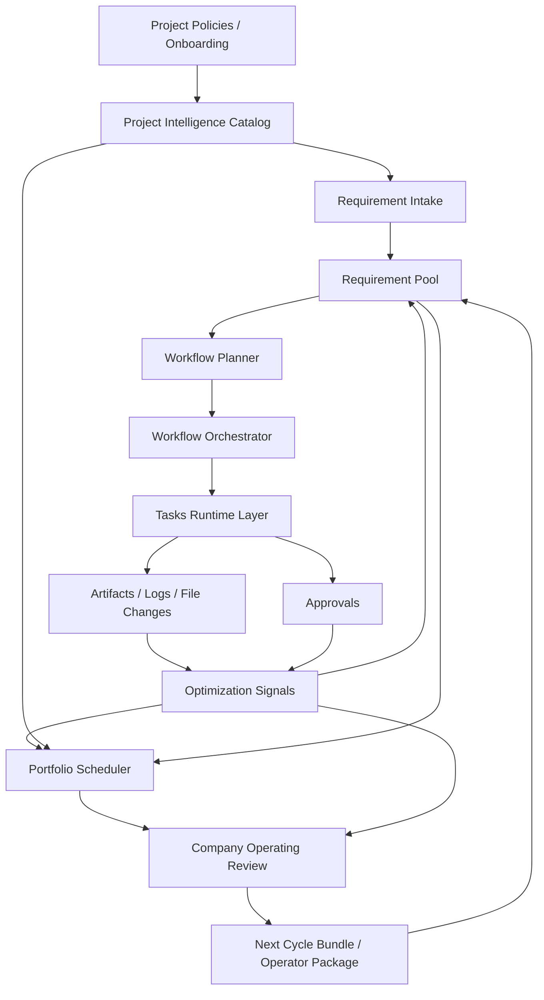

# Synapse Company Ops 最新架构设计

## 1. 目标

`Synapse-Network-Growing` 现在不是单一 dashboard，而是整个 Synapse 体系的公司级编排中枢。

它的职责是把这几层接起来：

1. 公司级 review 与 portfolio 决策
2. optimization signal 发现与转 requirement
3. requirement-first workflow orchestration
4. task runtime 与 approval 治理
5. project policy / onboarding / budget / rebalance
6. 结果回流到 signal、company review 和下一周期 bundle

## 1.1 设计原则边界

系统级硬约束已沉淀到：

1. `/Users/cliff/workspace/agent/Synapse-Network-Growing/docs/design-docs/system-design-principles.md`

后续所有设计与实现默认必须满足这些原则，尤其是：

1. 把模型当不稳定部件，不当同事
2. 错误路径按主路径设计
3. verification 独立于 implementation
4. 多代理用于隔离不确定性
5. runtime / subagent 必须有生命周期与 cleanup

## 1.2 新增的执行约束层

现在 `project policy` 不再只负责路径和发布模式，还负责显式执行约束。

每个项目策略现在都包含两组控制面：

1. `capability_matrix`
2. `interrupt_policy`

### capability matrix

当前统一字段为：

1. `shell_access`
2. `git_read`
3. `git_write`
4. `git_push`
5. `network_access`
6. `publish`

它们的作用不是“给 UI 展示一下”，而是直接进入：

1. planner output
2. workflow step `approval_policy`
3. delivery contract 的 `auto_publish_allowed`
4. step dispatch 前的 policy interrupt

### interrupt policy

当前统一字段为：

1. `operator_confirmation_actions`
2. `auto_pause_on_events`
3. `auto_abort_on_events`

它定义了：

1. 哪些动作必须转 operator confirmation
2. 哪些事件要把 workflow 自动暂停
3. 哪些事件要直接终止并转入 revision / incident 路径

### 当前已接入的行为

当前系统已经做到：

1. planner 会把 capability/interrupt 约束写入每个 workflow step
2. step prompt 会显式展示 capability contract，而不是让 agent 猜
3. 如果某个 step 所需能力被 policy 禁用，dispatch 前会生成 `capability_interrupt` artifact
4. 触发 `capability_denied` 时，workflow 会按 interrupt policy 自动 `pause / block`
5. delivery contract 的 auto publish 只会在 `git_push + publish` 都允许、且不要求 operator confirmation 时开启

## 2. 当前推荐的数据库策略

## 2.1 是否要立刻换成更强的数据库

短答案：

1. 当前 `/api/requirements` 的慢，不是第一优先级的数据库类型问题。
2. 先优化查询路径和计算方式，比先把 SQLite 换成 PostgreSQL 更划算。

这次排查里看到的主要瓶颈是：

1. `GET /api/requirements?sort=score` 会对每条 requirement 计算 score。
2. 旧实现里这些 score 计算会重复构建 `project catalog`、重复查 routing / signal 上下文。
3. 这更像是“单请求内重复全量扫描”，不是 SQLite 单纯扛不住。

所以当前优先级建议是：

1. 先做单请求级别的上下文复用与缓存。
2. 再做关键查询日志和慢请求观测。
3. 当并发用户、后台调度线程、审批流和 review 刷新都明显增多后，再迁移 PostgreSQL。

## 2.2 推荐路线

### 阶段 A：继续使用 SQLite，但把查询做对

适用于当前本地单机、单 operator、开发环境。

先做：

1. 单请求复用 `project_catalog`
2. 单请求复用 signal-derived score context
3. 关键接口打点日志
4. 必要时把 `requirements` 的 score snapshot 物化
5. 对慢 aggregation 改成定时刷新而不是每次在线重算

### 阶段 B：迁移 PostgreSQL

适用于：

1. 多人同时操作 dashboard
2. 多个后台 worker 并发写入
3. review / scheduler / signals 高频刷新
4. 需要更稳定的锁、索引、并发事务与分析查询

迁移时建议：

1. 保持 SQLAlchemy model 不变
2. 先让 local 继续 SQLite，prod 改 PostgreSQL
3. 把 signal summary / company review / requirement score snapshot 做成可重建表

## 2.3 最终建议

现在不建议因为 `/requirements` 慢就立刻换库。

更合理的顺序是：

1. 先优化计算路径
2. 先加日志和慢请求观测
3. 再看 PostgreSQL 是否成为必要投入

## 3. 服务端日志设计

## 3.1 当前新增的日志模块

新增了统一日志工具：

1. `/Users/cliff/workspace/agent/Synapse-Network-Growing/server/logging_utils.py`

它负责：

1. 配置控制台日志
2. 配置滚动文件日志
3. 统一 key=value 风格事件日志
4. 统一 timed operation 打点

日志配置来自：

1. `/Users/cliff/workspace/agent/Synapse-Network-Growing/server/config.py`

默认日志文件位置：

```text
/Users/cliff/workspace/agent/Synapse-Network-Growing/server/logs/ops-dashboard.log
```

## 3.2 当前已经记录的关键信息

### HTTP 层

通过 `server/main.py` 记录：

1. `request_id`
2. `method`
3. `path`
4. `query`
5. `status`
6. `duration_ms`

### requirement 层

重点记录：

1. `requirements_list`
2. `requirement_created`
3. `requirement_planned`
4. `requirement_started`
5. `requirement_paused`
6. `requirement_closed`
7. `requirement_published`
8. `requirement_deleted`
9. `requirement_revised`
10. `requirement_queue_advanced`
11. `requirement_queue_idle`

### optimization signal 层

重点记录：

1. `optimization_signals_refresh`
2. `optimization_signal_converted`
3. `optimization_signal_auto_intake`
4. `optimization_signals_list`

### company review 层

重点记录：

1. `company_review_get`
2. `company_review_refresh`
3. `company_review_refreshed`
4. `company_review_materialize_bundle`
5. `company_review_bundle_materialized`

## 3.3 下一步建议继续补的日志

如果你要继续增强可观测性，下一批最值得补的是：

1. planner 生成耗时与 step 数量
2. scheduler 每个 candidate 的决策原因摘要
3. approval 决策耗时和 backlog 大小
4. task runtime 的 provider / model / deferred session 状态
5. `Agents-Memory` ingest 成功率和延迟

## 4. Optimization Signal 的数据源

optimization signal 不是凭空生成的，它来自当前系统已经存在的执行证据。

当前主要有三类来源：

## 4.1 `bug_report`

来源：

1. `artifacts` 表里 `artifact_type = bug_report`

由 requirement workflow 在这些步骤失败时产生：

1. `review`
2. `test`
3. `bugfix` 后重测失败

Signal service 会按这些信息聚合：

1. `failed_checks`
2. `step_type`
3. `requirement`
4. `project root`

形成：

1. `signal_type = bug_report`

## 4.2 `delivery_blocker`

来源：

1. `artifacts` 表里 `artifact_type = delivery_state`

当 delivery state 里出现：

1. `publish_status = blocked` 或 `review_ready`
2. `publish_blockers` 非空

Signal service 会把这些 blocker 聚合成：

1. `signal_type = delivery_blocker`

## 4.3 `manual_override`

来源有两类：

1. `approval_requests`
2. `approvals`

也就是：

1. requirement 级人工审批请求
2. task 级人工审批记录

当某个项目反复把人拉进来做决策时，就会形成：

1. `signal_type = manual_override`

## 4.4 当前还没有直接接入但值得接入的来源

## 5. 从 Harness Engineering 可以直接借鉴什么

参考：

1. `https://harness-books.agentway.dev/book1-claude-code/preface.html`
2. `https://harness-books.agentway.dev/book1-claude-code/chapter-07-multi-agent-and-verification.html`
3. `https://harness-books.agentway.dev/book1-claude-code/chapter-09-ten-principles.html`
4. `https://harness-books.agentway.dev/book1-claude-code/appendix-a-checklists.html`

它和我们现在的方向高度一致，但也给了几条更具体的约束原则。

### 5.1 可以直接借鉴的核心判断

1. 不要把模型当同事，要把模型当不稳定部件。
2. Prompt 不是人格设定，而是控制面的一部分。
3. Query loop、恢复分支、权限、验证和回滚都应该算主路径，不是异常补丁。
4. 多代理的价值不是“多开几个 worker”，而是把 research / implementation / verification 的不确定性隔离开。
5. verification 必须独立成阶段，不能让 implementation 自证正确。
6. 子代理和后台 runtime 都有生命周期，必须有 start / stop / cleanup / transcript / abort 传播。
7. 错误恢复最怕设计成死循环，所以错误路径本身也要有预算与熔断。

### 5.2 对 Synapse Company Ops 最值得落地的改进

#### A. 把 Harness 约束显式化

现在我们已经有：

1. project policy
2. validation contract
3. delivery contract
4. scheduler / rebalance / budget

下一步建议再补：

1. requirement 级 execution budget
2. step 级 max tool-call / max bugfix / max resume 次数
3. “谁可以动 shell / git / publish / network”的 capability matrix
4. 对高风险动作的统一 interrupt / abort 语义

#### B. 把错误恢复做成产品功能

这次 requirement `#40` 的事故说明，我们已经需要更强的恢复设计。

建议继续补：

1. circuit breaker 后自动创建 `operator review` 与 `infra incident` requirement
2. 将重复错误、孤儿任务、runtime stale session 做成标准 incident taxonomy
3. 在 RequirementDetail 与 OptimizationSignals 中单独展示 `recovery narrative`
4. 对 paused / failed / circuit-broken workflow 增加“下一步建议动作”

#### C. 把多代理真正分层

现在 requirement workflow 已经有 implementation / review / test / closeout，但还可以更像 harness：

1. 增加 `research` 与 `synthesis` 的显式阶段
2. coordinator 负责收束 worker 结果，不允许把理解责任继续外包
3. verification worker 必须和 implementation worker 隔离 runtime session / memory scope
4. subagent transcript 与 cleanup 状态进入 artifact 和日志

#### D. 把上下文治理从“能用”升级到“可治理”

建议继续做：

1. requirement / task / agent session 的 context budget 指标
2. compact 触发条件与 compact 后摘要 artifact
3. stale memory / stale assumption 的 verify-and-rewrite 机制
4. 在 Agents-Memory 中区分长期规则、会话记忆、临时证据

### 5.3 现在最应该优先做的 P-next

1. `Research + Synthesis` 显式阶段化
2. runtime / subagent lifecycle artifacts 与 cleanup telemetry
3. capability matrix + dangerous tool interrupt policy
4. recovery narrative 面板与 incident taxonomy
5. context budget / compact / stale memory verification

下一步可以继续接这些来源：

1. test flakiness
2. queue starvation
3. runtime timeout
4. repeated rollback
5. low validation coverage
6. docs drift
7. onboarding friction

## 5. 模块交互设计

## 5.1 总体数据流



## 5.2 各模块职责

### Project Policies / Onboarding

负责定义：

1. 项目根路径
2. 可写范围
3. 禁止范围
4. required checks
5. release mode
6. autonomy mode
7. rebalance / preemption / budget

这些信息被：

1. requirement routing
2. scheduler
3. delivery gate
4. company review

共同使用。

### Project Intelligence

负责把多个底层数据合成项目画像：

1. readiness
2. bug pressure
3. delivery pressure
4. manual override pressure
5. automation coverage

它是这几层的共享输入：

1. requirement score
2. signal score
3. portfolio scheduler
4. company review

### Requirement Pool

需求池是顶层工作对象，系统真正的“要做什么”在这里表达。

requirement 支持：

1. intake
2. routing
3. dependencies
4. planning
5. start / pause / revise / close / publish

### Workflow Planner

负责把 requirement 变成 machine-readable workflow：

1. workflow steps
2. acceptance checks
3. validation plan
4. delivery contract

### Workflow Orchestrator

负责驱动 requirement 从 planned 到 done：

1. 创建 workflow run
2. 派发 task
3. 跟踪步骤状态
4. 生成 artifacts
5. 失败时进入 bugfix loop
6. closeout 后回写 delivery state

### Task Runtime

这里是兼容执行层，负责：

1. 把 workflow step 落到 task
2. 调用真实 runtime
3. 落日志、输出、diff、history

### Approvals

负责高风险动作的人类决策边界，不应该承接普通执行。

### Optimization Signals

负责把执行后的异常、摩擦、阻塞沉淀成可排序、可转 requirement 的 signal。

### Portfolio Scheduler

负责跨项目决定：

1. 谁先做
2. 谁延后
3. 哪些 signal 该 intake
4. 是否 rebalance
5. 是否提示 preempt candidate

### Company Operating Review

负责把当前整个 portfolio 的状态汇总成：

1. summary
2. project highlights
3. bottlenecks
4. incidents
5. next cycle recommendations
6. requirement bundle
7. operator review package

## 6. `/requirements` 慢的当前结论

当前阶段的结论是：

1. 慢主要来自 score/routing 的重复计算。
2. 不是先换库就能自动解决的问题。
3. 当前已经应该优先做：
   1. 单请求上下文复用
   2. 慢请求日志
   3. 关键聚合物化

如果这些做完后仍然因为并发、锁竞争、后台线程和多用户访问带来压力，再进入 PostgreSQL 是顺理成章的下一步。
