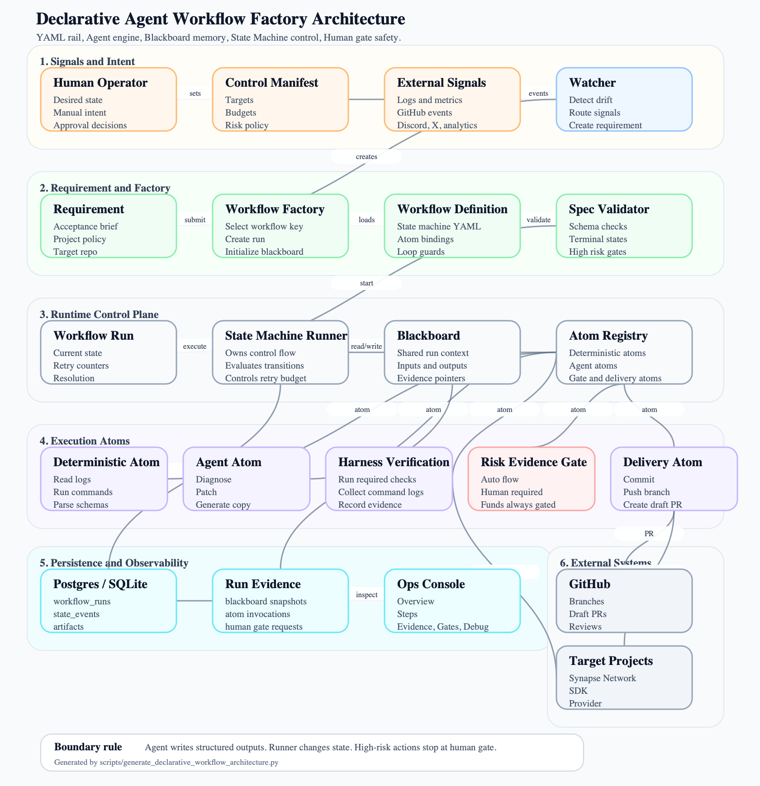

# Declarative Agent Workflow Factory

## Summary

This document defines the next architecture layer for Synapse Company Ops: **YAML is the rail, Agent is the engine**.

The goal is not to downgrade Agent-First work into traditional CI/CD. The goal is to separate the parts that must be deterministic from the parts where model reasoning creates leverage:

1. workflow control flow is declared in a governed spec, not hidden in Python `if backend == ...` branches.
2. agents perform the hard cognitive work: diagnosis, synthesis, code changes, copywriting, support intent splitting, and repair guidance.
3. deterministic atoms perform trusted execution: reading logs, running commands, parsing schemas, writing artifacts, opening PRs, and enforcing gates.
4. the Meta-Builder Agent may later generate workflow specs, but it must generate **declarative state machine YAML**, not long-lived raw Python services.
5. complex workflows use **State Machine + Blackboard**, not one-way DAGs.

This keeps the system flexible enough to create new operating workflows from high-level human intent, while still safe enough for a business that touches production systems, external spend, auth, contracts, and USDC settlement.

## Overall Architecture Diagram

This diagram is generated as a large SVG asset so the text stays readable when embedded in docs or opened directly. Regenerate it with:

```bash
python scripts/generate_declarative_workflow_architecture.py
```



Open the vector source when zooming or editing: [declarative-agent-workflow-factory-architecture.svg](../assets/declarative-agent-workflow-factory-architecture.svg).

The most important boundary in the diagram is this:

1. agents can write structured outputs into Blackboard.
2. deterministic atoms can execute trusted operations and collect evidence.
3. only the State Machine Runner changes workflow state.
4. high-risk delivery always stops at Risk-Evidence Gate or Human Oracle.

## Core Architecture

### Human Intent / Desired State

The operator declares what should exist or remain true:

1. "Gateway API success rate must stay above 99%."
2. "Discord support questions should receive accurate replies."
3. "Publish three high-quality X posts when product changes ship."
4. "If Agent Ops breaks itself, open a repair PR but never auto-deploy."

The desired state is not a script. It is the control-plane target.

### Watcher

Watcher compares current state against desired state and external events:

1. metrics and logs
2. runtime failures
3. GitHub events
4. Discord / X / support webhooks
5. product analytics
6. operator-created intents

Watcher only decides whether a workflow run should be created. It does not repair code, write copy, or approve high-risk actions.

### Workflow Factory

Workflow Factory turns an intent into a governed workflow spec.

In v1, most workflow specs are written by humans. In later phases, a Meta-Builder Agent can draft a workflow spec, but activation requires:

1. schema validation
2. sandbox execution against fixtures
3. risk policy review
4. human approval

The factory does not let agents create always-on raw Python daemons directly.

### State Machine Runner

The runner executes workflow states, evaluates transitions, applies retry budgets, and persists timeline events.

Agents do not choose the next state. Agents can produce structured recommendations and evidence, but only the deterministic runner changes workflow state.

### Blackboard

Blackboard is the shared workspace for a workflow run. It prevents context fragmentation between nodes.

Examples of blackboard entries:

1. trigger payload
2. log excerpts and error fingerprints
3. diagnosis summary
4. changed files
5. patch summary
6. verification command results
7. risk score and evidence score
8. human approval decision
9. observation metrics

### Agent Atom

Agent atoms perform high-context reasoning or generation.

Examples:

1. diagnose an error from logs and code context
2. generate a patch
3. split a Discord message into technical and funds-related intents
4. write brand-safe social copy
5. produce repair guidance after failed verification

Agent atoms must emit structured output that matches a declared schema.

### Deterministic Atom

Deterministic atoms are trusted building blocks implemented in code.

Examples:

1. read a log file
2. query a read-only database
3. run `pytest`
4. validate JSON / YAML schema
5. create an artifact
6. open a PR
7. send a Discord reply
8. enforce a cost or funds kill switch

They are boring on purpose. Boring atoms are how we let creative agents operate safely.

PR delivery atoms have one hard boundary: agents may commit, push a requirement branch, and open or update a GitHub Draft PR, but they must not merge it. Before pushing, delivery atoms must smart-sync the remote PR branch, preserve human commits through a clean rebase when possible, and route rebase conflicts to `awaiting_operator` instead of overwriting the branch.

### Harness / Verification

Harness executes required commands and records authoritative evidence.

Verification Agent interprets acceptance, plan, diff, self-run evidence, harness evidence, and risk policy. Harness does not do semantic judgment; Verification Agent does not write code.

For `agent_self_repair`, quick deterministic guardrails run inside the workflow worker, but the full final regression gate is asynchronous:

1. after quick gates pass, the workflow enters `awaiting_ci`;
2. `scripts/ci/ci_runner.py` streams full regression output to `runtime/ci-runs/*.log`;
3. the runner writes an atomic `*.exit_code` marker when complete;
4. `ci_status_sweep` reads marker files, records bounded evidence, then resumes the workflow to PR handoff or routes failure to `awaiting_operator`.

The final regression runner must not use in-memory `capture_output=True`; logs can be large and must stream directly to disk. The sweep must have a runtime cap so stale-lock recovery never races with a slow sweep.

### Risk-Evidence Gate

Risk-Evidence Gate decides whether a result can auto-flow or must stop for a human.

High evidence does not override high risk. Funds, settlement, contracts, auth, production deploys, and external paid spend always require a human gate.

### Human Oracle

Human Oracle is the operator approval layer.

The operator should see only the meaningful queues:

1. approve or reject generated artifacts
2. resolve failed workflows that exhausted budgets
3. approve high-risk actions
4. accept useful SOP / checklist updates

### Lark Notification Policy

Lark is a paging and decision surface, not the workflow source of truth. Full context remains in `/workflows/:id`.

v1 uses four notification channels:

1. `alert`: P0/P1 interruption only, including SLO drift, funds/settlement/auth/contract/production risk, runner crash or stale state, retry budget exhausted, kill switch, and high-risk workflow failure.
2. `approval`: human decision required, including human gate creation, risk-evidence gate `human_required`, manual requirement approval, deploy approval, and approve/reject/continue_retry receipts.
3. `requirement`: workflow notifications, including requirement created, workflow started, workflow succeeded, low-risk workflow failure, assets ready/failed, and auto approval results.
4. `release`: delivery activity, including PR opened, PR creation failed, branch pushed, release blocked, CI/deploy/observing results.

Events that must not page Lark:

1. ordinary state transitions
2. successful atom invocations
3. artifact creation
4. blackboard snapshots

All Lark cards must include service, priority, risk level, event type, summary, next action, object references, and direct Ops Console links. The routing policy is centralized in code so Watcher, State Machine Runner, Risk-Evidence Gate, Human Gate, and Delivery Atom do not each invent their own channel logic.

## Why Not Plain YAML DAG

### DAG Dead End

A one-way DAG like `collect -> diagnose -> patch -> verify -> open_pr` breaks down when `verify` fails.

Agent systems need reflection loops. If tests fail, the natural transition is `verify -> patch -> verify` until the repair budget is exhausted. A plain DAG either fails too early or smuggles loops into hidden code.

### Context Fragmentation

If `diagnose` and `patch` are independent nodes with independent conversations, the patching agent must relearn why the diagnosis happened.

This wastes tokens and causes memory loss. The blackboard keeps diagnosis, evidence, failures, and decisions in one run context.

### Agent Output Parser Boundary

Deterministic atoms need structured input. Agent atoms produce language.

Therefore every agent atom must define an output schema. Raw model output is preserved for audit, but downstream atoms only consume parsed payloads.

### Conclusion

v1 uses **YAML State Machine**, not pure DAG.

The workflow spec defines states, transitions, guards, terminal states, retry budgets, blackboard persistence, risk policies, and atom bindings. The runner owns control flow. Agents own reasoning inside states.

## Workflow State Machine Spec

Example workflow: `gateway_reliability_repair`.

```yaml
workflow_key: gateway_reliability_repair
version: 1
description: Repair Gateway reliability drift with bounded agent self-repair.
initial_state: collect_context

limits:
  max_patch_attempts: 2
  max_active_seconds: 7200
  max_cost_usd: 5.00

blackboard:
  persist_keys:
    - trigger
    - error_fingerprint
    - log_excerpt_artifact_id
    - diagnosis
    - patch_summary
    - changed_files
    - verification_plan_artifact_id
    - verification_evidence_artifact_id
    - risk_score
    - evidence_score
    - human_gate_decision
    - observation_result

states:
  collect_context:
    atom: read_gateway_logs
    transitions:
      - if: context_collected
        goto: diagnose
      - if: no_signal
        goto: done

  diagnose:
    agent: reliability_diagnoser
    output_schema: schemas/reliability_diagnosis.schema.json
    transitions:
      - if: diagnosis.action == "patch"
        goto: patch
      - if: diagnosis.action == "needs_operator"
        goto: awaiting_operator
      - if: diagnosis.action == "no_issue_found"
        goto: done

  patch:
    agent: software_engineer
    session_scope: requirement
    output_schema: schemas/patch_result.schema.json
    transitions:
      - if: patch_result.changed_files_count > 0
        goto: verify
      - if: counters.patch_attempts >= limits.max_patch_attempts
        goto: awaiting_operator

  verify:
    atom: run_gateway_verification
    transitions:
      - if: verification.passed
        goto: risk_gate
      - if: verification.failed and counters.patch_attempts < limits.max_patch_attempts
        increment: patch_attempts
        goto: patch
      - if: verification.failed and counters.patch_attempts >= limits.max_patch_attempts
        goto: awaiting_operator

  risk_gate:
    atom: risk_evidence_gate
    transitions:
      - if: gate.decision == "auto_flow"
        goto: open_pr
      - if: gate.decision == "human_required"
        goto: awaiting_operator

  open_pr:
    atom: create_pull_request
    transitions:
      - if: pr_created
        goto: observing
      - if: pr_failed
        goto: awaiting_operator

  observing:
    atom: observe_gateway_success_rate
    wait:
      duration_minutes: 30
    transitions:
      - if: observation.restored
        goto: done
      - if: observation.not_restored and counters.patch_attempts < limits.max_patch_attempts
        increment: patch_attempts
        goto: patch
      - if: observation.not_restored
        goto: awaiting_operator

  awaiting_operator:
    terminal: true
    resolution: route_to_human

  done:
    terminal: true
    resolution: completed
```

Required spec rules:

1. every workflow has `initial_state`.
2. every workflow has at least one terminal state.
3. every loop has a counter guard.
4. every agent state declares `output_schema`.
5. every high-risk state routes through `risk_gate` or `awaiting_operator`.
6. every transition emits a `workflow_state_events` row; normal transitions must not create artifact rows.

## Blackboard Contract

Blackboard is the per-run shared memory for workflow execution.

Implemented storage:

1. `workflow_definitions` stores governed workflow specs and built-in workflow discovery records.
2. `workflow_runs` is the new declarative run truth and stores `workflow_key`, `current_state`, `status`, `resolution`, `retry_counters_json`, and compact final-KV `blackboard_json`.
3. `blackboard_snapshots` may store compact snapshots for audit, but UI must not depend on it to reconstruct per-step input/output.
4. `workflow_artifacts` stores raw agent output, command logs, large text, screenshots, diffs, PR evidence, and other heavy evidence. Its `workflow_run_id` directly references `workflow_runs.id`.
5. `workflow_state_events` stores every transition event with `from_state`, `to_state`, condition, counters, and payload.
6. `atom_invocations` stores every deterministic/agent atom call, input summary, output schema, artifact ids, duration, status, and error excerpt.
7. `human_gate_requests` stores high-risk or terminal operator gates and writes operator decisions back to blackboard.
8. every state reads only declared blackboard keys and writes only declared output keys.

Legacy execution ORM models and fixed `workflow_steps` are not part of the new execution truth. Old physical tables may remain in a local SQLite file until the operator resets or archives the database, but the application no longer declares them as active models and new declarative workflows must not write through them.

Blackboard is not a hidden prompt dump or history log. It is final KV memory for the current run. Do not persist `state_outputs`, `transition_history`, raw artifacts, long transcripts, or ordinary transition history in `blackboard_json`.

Workflow detail UI should use a chronological `timeline[]` API projection assembled from state events, atom invocations, artifacts, and human gates. The timeline is not a physical table. It is the operator narrative for debugging and review.

Do not build a Step Inspector that claims to reconstruct historical input/output from the final blackboard. If exact replay is needed later, add a dedicated replay event store rather than stuffing history back into Blackboard.

## Agent Atom Contract

Agent atoms must be powerful but bounded.

Contract:

1. every agent atom has an input contract, output schema, model/runtime configuration, and risk classification.
2. raw output is always saved as an artifact.
3. parsed output is saved separately and is the only payload downstream deterministic atoms can consume.
4. JSON or schema parsing failure may trigger one parser-repair turn.
5. after parser repair fails, the workflow routes to `awaiting_operator` or a safe failure state.
6. agent atoms can recommend next actions but cannot mutate workflow state directly.
7. agent atoms cannot call high-risk external actions directly; they must request a deterministic atom behind policy gates.

This preserves Agent-First reasoning while preventing models from becoming unbounded workflow owners.

## Risk-Evidence Matrix

| Scenario | Risk | Evidence Quality | Decision |
| --- | --- | --- | --- |
| Peripheral code bug | Low / Medium | High: tests, lint, diff | Auto-flow to PR or low-risk merge policy |
| Gateway settlement bug | Critical | High: tests and local evidence | Human gate required |
| X / Reddit post draft | Medium | Low: model judgment and brand rubric | Human gate required |
| Refund or funds movement | Critical | Medium / High: read-only chain and DB checks | Human gate required |
| Read-only report | Low | Low / Medium: data query evidence | Auto-generate artifact; do not auto-trigger business action |
| Auth or permission change | Critical | High: tests and review evidence | Human gate required |
| External paid spend | High | Medium: budget and creative checks | Human gate required |

Policy:

1. high risk always stops for a human, even when evidence is strong.
2. low risk plus high evidence may auto-flow.
3. low risk plus low evidence may auto-flow only to an artifact, never to irreversible action.
4. funds, settlement, contracts, production deploys, auth, secrets, and external paid spend always require human approval.
5. risk and evidence scores are deterministic policy outputs, not model-only opinions.

## Scenario Simulation

### Scenario 1: Agent System Self-Repair

Trigger:

Watcher sees Ops Dashboard task runner crash three times or finds a Python traceback in `ops-dashboard` logs.

State flow:

`collect_context -> diagnose -> patch -> verify -> open_pr -> awaiting_operator`

Agent capability:

The software engineer agent reads logs, source context, recent changes, and test failures. It identifies the likely root cause and writes a focused patch.

Deterministic atom:

The runner collects logs, applies the patch in the workspace, runs sandbox tests, records command evidence, and opens a PR.

Human gate:

Always required before merging or deploying changes to the Agent Ops system itself.

Verdict:

Satisfied. The agent does the hard debugging work, while deterministic tests and human approval protect the control plane.

### Scenario 2: Synapse-Network Gateway Bug Repair

Trigger:

Desired state drift: Gateway 5xx rate exceeds the configured threshold or settlement confirmation latency crosses the alert boundary.

State flow:

`collect_context -> diagnose -> patch -> verify -> risk_gate -> open_pr -> observing -> done`

Agent capability:

The reliability agent extracts an error fingerprint from logs, connects it to code paths, proposes the repair, updates or adds tests, and explains the failure mode.

Deterministic atom:

Atoms read logs, run gateway tests, capture diff and command evidence, open the PR, and observe production metrics after deployment.

Human gate:

Required for settlement, contract, auth, production, or funds-adjacent changes. The PR can be prepared automatically, but final production movement is gated.

Verdict:

Satisfied. The design separates delivery verification from business verification: tests can pass before success rate recovers, so the workflow enters `observing`.

### Scenario 3: X / Reddit Daily Operations

Trigger:

Desired state says three product update posts should be drafted this cycle, while current published or approved post count is below target.

State flow:

`collect_material -> draft_posts -> brand_review -> awaiting_operator -> publish -> done`

Agent capability:

The growth agent turns commits, docs updates, and market context into platform-specific copy with appropriate tone and CTA.

Deterministic atom:

Atoms collect GitHub commits, read approved product context, validate character limits, save drafts, and publish through platform APIs only after approval.

Human gate:

Required before posting. Social copy has subjective brand and reputational risk that evidence cannot fully prove.

Verdict:

Satisfied. Agent handles creative work; deterministic atoms handle collection and publishing; human keeps brand control.

### Scenario 4: Growth Campaign

Trigger:

Operator intent: "Launch a free API credit campaign for new developers."

State flow:

`strategy -> asset_generation -> internal_review -> awaiting_operator -> publish_assets -> observing -> done`

Agent capability:

The growth strategy agent decomposes a campaign into landing page copy, email sequence, social posts, launch checklist, and measurement plan.

Deterministic atom:

Atoms create artifacts, validate links, push approved content to deployment targets, schedule emails, and read analytics after the observation window.

Human gate:

Required before launch because campaign positioning, incentives, and external messaging affect business risk.

Verdict:

Satisfied. The system becomes an execution force multiplier while the operator keeps final market judgment.

### Scenario 5: Discord Support And Technical Assistance

Trigger:

Discord webhook receives: "My USDC deposit did not arrive. Also how do I integrate the API?"

State flow:

`classify_intent -> retrieve_context -> draft_response -> risk_gate -> reply_or_await_operator -> done`

Agent capability:

The support agent splits mixed intent into technical onboarding and funds-related support. It uses docs for integration guidance and summarizes the funds issue without inventing settlement actions.

Deterministic atom:

Atoms run RAG search, query read-only ledger / chain state, validate confidence thresholds, send low-risk technical replies, and create a human approval task for refunds.

Human gate:

Required for refund, settlement adjustment, wallet action, or any irreversible funds movement.

Verdict:

Satisfied. The architecture supports fast automated support where safe, while funds actions remain hard-gated.

## Comparison

### Compared With Free Multi-Agent Meetings

Free-form agents can discuss endlessly, lose state, and make unsafe decisions. This design gives agents specific jobs inside governed states.

### Compared With Traditional CI/CD

Traditional CI/CD executes known steps. This system uses agents for diagnosis, synthesis, repair, writing, support reasoning, and campaign planning. CI-like atoms only provide trusted rails.

### Compared With One-Way YAML DAG

State machines support loops, retries, observation states, and human intervention. Plain DAGs are too rigid for agent self-correction.

### Compared With Hand-Written Python Workflows

Hand-written workflows become hidden if-else trees. Declarative specs make workflow behavior inspectable, testable, and eventually generatable by a Meta-Builder Agent.

### Compared With Fully Dynamic Raw Code Generation

Raw code generation is flexible but unsafe and hard to maintain. This design lets agents generate workflow specs that compose trusted atoms, then requires sandbox validation and human approval before activation.

## Implementation Roadmap

### Phase 1: State Machine Spec Parser And Validator

Implement schema validation for workflow YAML, terminal states, transition guards, loop budgets, risk gates, and atom references.

### Phase 2: Blackboard Persistence

Persist compact blackboard state under execution run metadata and move large payloads into artifacts.

### Phase 3: Atom Registry

Create a registry for deterministic atoms and agent atoms with input/output contracts, permission scopes, and risk classification.

### Phase 4: `gateway_reliability_repair`

Implement the first production-relevant workflow because gateway reliability is the highest leverage and highest risk operational path.

### Phase 5: `agent_self_repair`

Add self-repair for Synapse-Network-Growing after the gateway workflow proves the runner, blackboard, and risk gate.

### Phase 6: Meta-Builder Agent

Allow the Meta-Builder Agent to draft workflow YAML from human intent. Generated workflows remain inactive until schema validation, sandbox fixtures, and human approval pass.

### Phase 7: Support, Social, And Growth Workflows

Add lower-risk operating workflows after engineering workflows are observable and safe.

## Test Plan

1. State machine validation: rejects missing terminal states, missing retry budgets, invalid atom references, and high-risk paths without gates.
2. Blackboard read/write: persists final KV keys, stores large evidence as artifacts, and records transition events outside blackboard.
3. Agent output parsing: accepts valid schema payloads, stores raw output, repairs one parse failure, and fails safely after repeated parse errors.
4. Risk-evidence gate: routes high-risk actions to humans even with strong evidence; auto-flows only low-risk high-evidence actions.
5. Session reuse: repair loops preserve the execution agent session for a requirement unless policy explicitly starts a new run.
6. Observation state: verifies delivery success and business success can be separated.
7. Scenario fixtures: covers agent self-repair, gateway bug repair, social operations, growth campaign, and Discord support.

## Assumptions

1. This document is a draft architecture, but the first runtime slice now exists for `agent_self_repair` and `gateway_reliability_repair`.
2. Fixed-step execution, legacy bugfix execution, and old workflow step compatibility are removal targets, not fallback paths for new complex workflows.
3. Workflow specs are config-as-code and should be reviewed like code.
4. Meta-Builder output is never activated without validation and human approval.
5. The first production hardening target is `gateway_reliability_repair`, while `agent_self_repair` remains PR-only plus human approval.
