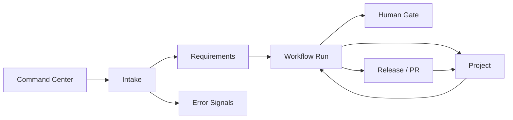
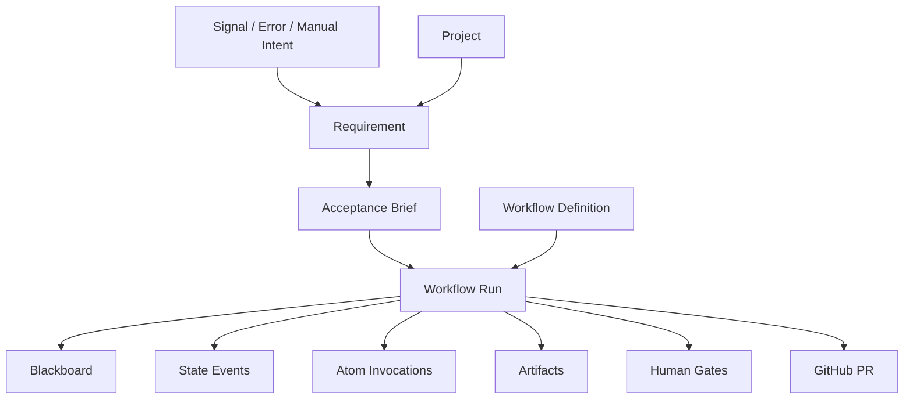

# Workflow Factory Frontend Control Plane

## Summary

当前后端已经具备 Declarative Workflow Factory 的核心骨架，但前端还没有把这套系统表达成一个清晰的 Operator Control Plane。

The current visual implementation source is `docs/front/growing原型.fig` plus the exported Stitch prototype under `docs/front/stitch_declarative_agent_factory/`. The implementation contract is tracked in [Figma Driven Human-Agent Control Plane Frontend](frontend-control-plane-figma-implementation.md).

现在页面的问题不是“缺少更多表格”，而是缺少一张用户一眼能看懂的地图：

```text
Signal / Manual Intent
-> Requirement
-> Acceptance Brief
-> Workflow Selection
-> Workflow Run
-> State Machine
-> Atom Invocations
-> Blackboard / Evidence
-> Human Gate / PR / Release / Observe
```

前端的目标应该是让一人公司 operator 每天只回答三个问题：

1. 现在系统在处理什么？
2. 哪些事情需要我介入？
3. 每条链路为什么停在这里，下一步是什么？

## Current Implementation Fit

### Already Satisfied

当前代码已经满足这些基础能力：

| Area | Status | Notes |
|---|---|---|
| Declarative workflow run | satisfied | `workflow_runs.current_state/status/resolution/blackboard_json` 已作为新运行真相。 |
| State events | satisfied | `workflow_state_events` 记录状态流转。 |
| Blackboard persistence | satisfied | `blackboard_snapshots` 与 run blackboard 都已落库。 |
| Atom invocations | satisfied | `atom_invocations` 记录 state、atom、status、duration、artifact ids。 |
| Workflow artifacts | satisfied | `workflow_artifacts` 直接关联 workflow run。 |
| Human gates | satisfied | `human_gate_requests` 支持 `approve/reject/continue_retry`。 |
| Requirement readiness | satisfied | Requirement detail 已能返回 `workflow_readiness`。 |
| Manual workflow start | satisfied | `POST /api/requirements/{id}/workflow/start` 已可启动 declarative run。 |
| Workflow list/detail API | satisfied | `/api/workflows/runs`、`/api/workflows/runs/{id}`、definitions API 已存在。 |
| GitHub PR atom | satisfied | `open_*_pr` 已接入 VCS delivery + GitHub draft PR sync。 |

### Partially Satisfied

这些能力已有雏形，但还不是设计文档里的完整形态：

| Area | Current Gap | Required Next Step |
|---|---|---|
| YAML State Machine | built-in spec is Python dict | 增加真正的 workflow spec file loader / validator / versioning。 |
| Agent atom | default atoms are mostly deterministic stubs | 接入真实 planner/runtime adapter，并保存 raw output + parsed payload。 |
| Output schema | agent states declare schema path | 需要真正执行 schema validation、parse repair、parse failure human gate。 |
| Risk-Evidence Gate | only checks simple risk flags | 实现 risk score + evidence score + policy matrix。 |
| Workflow Factory | only run definitions exist | 需要 Factory page：从 intent 选择/生成 workflow spec，sandbox 后激活。 |
| Observation state | happy-path restored stub | 接入真实 metrics/log query，并支持 observation window。 |
| Frontend graph | state cards only | 需要可读的 state machine rail、loop、current state、blocked reason。 |
| Operator next action | scattered buttons | 需要统一 `Next Action` 面板。 |
| Data reset | missing | 需要 local/staging 的 Runtime Data Reset 管理入口。 |

### Not Yet Satisfied

这些能力仍未完成：

1. Meta-Builder Agent 生成 workflow spec。
2. Workflow spec sandbox fixture 验证。
3. Workflow definition lifecycle：draft、sandbox_passed、approved、active、retired。
4. Full parser layer：raw model output -> schema parsed payload -> downstream atom。
5. Human gate resume semantics：approve 后恢复到哪个 state 仍需明确。
6. Production-safe data retention / archive / cleanup policy。
7. SOP Ledger / executable checklist 回写。
8. Cross-workflow dependency view。

## Product Positioning

这个前端不应该叫传统后台，也不应该继续像任务列表工具。

推荐定位：

```text
Synapse Agent Ops = Agent-First Company Control Plane
```

它的 UI 不是给“项目经理填单”用的，而是给一个 operator 指挥 agent 工厂用的。

## Visual Direction

### Visual Thesis

克制、密集、工程化的控制台：像 Linear + Datadog + GitHub PR queue 的混合体，用清晰状态线和证据面板表达复杂自动化，而不是用卡片堆装饰复杂性。

### Content Plan

1. 顶部永远先展示当前系统健康和 operator 待处理事项。
2. 每个对象页面都必须展示“它在整条链路里的位置”。
3. Workflow detail 是主驾驶舱，展示 state machine、blackboard、atoms、artifacts、human gates。
4. Projects 和 Errors 不作为孤立管理页，而是成为 Workflow/Requirement 的上下文面。

### Interaction Thesis

1. 主链路用横向 rail 或 vertical timeline 表达，不再让用户猜状态字段。
2. 复杂信息采用 master-detail：左侧链路/列表，右侧 inspector。
3. Human Gate 是命令式操作面，必须有明确 risk、evidence、decision、impact。
4. 所有危险动作使用统一 confirm modal，不使用浏览器原生 confirm。

## Navigation Model

推荐主导航改为：

```text
Command Center
Intake
Requirements
Workflows
Human Gates
Projects
Releases / PRs
Knowledge
Settings
```

### 1. Command Center

作用：一人公司的每日驾驶舱。

显示：

1. Active workflow count
2. Awaiting operator count
3. Failed / budget exhausted count
4. Open PR count
5. New high-signal errors
6. Current system health
7. Recent state transitions

核心区块：

```text
Today Queue
- Needs approval
- Failed after retry budget
- PR waiting review
- New high-risk signal

Active Runs
- workflow_key
- current_state
- age
- last_atom
- next action
```

Command Center 不创建复杂对象，只负责路由 operator 去正确页面。

### 2. Intake

作用：展示信号来源与过滤结果。

包含：

1. Errors / runtime log fingerprints
2. Manual intents
3. Future Discord / X / GitHub / analytics signals
4. Deduped signal groups
5. Discovery recommendation

旧 `/errors` 不应该删除，而应该并入 Intake，重命名为：

```text
Intake -> Error Signals
```

错误仍然需要，因为它是 Agent Ops 的自动发现入口。

### 3. Requirements

作用：记录“为什么做、做成什么、约束是什么”。

Requirement list 应展示：

1. title
2. project
3. source kind
4. state
5. acceptance readiness
6. active workflow summary
7. next action

Requirement detail 应重新布局为：

```text
Header
- title
- project
- source
- state
- active workflow link
- next action

Lifecycle Rail
Intent -> Acceptance -> Workflow Selected -> Running -> PR / Gate -> Done

Left: Requirement Brief
- description
- acceptance brief
- scope constraints
- expected evidence

Right: Workflow Readiness Inspector
- assets status
- recommended workflow
- can start?
- blocking reason
- generate/start buttons
```

Requirement 页面不应该展示 atom 明细，atom 明细属于 Workflow Run。

### 4. Workflows

Workflows 应拆成三个 tab：

```text
Definitions | Runs | Factory
```

#### Definitions

展示可用 workflow specs：

1. workflow key
2. version
3. status
4. states count
5. risk policy
6. last sandbox result
7. activation status

需要支持：

1. view spec
2. view graph
3. validate spec
4. sandbox run
5. activate / retire

#### Runs

展示所有 workflow run：

1. workflow key
2. requirement
3. current state
4. status
5. age
6. retry counters
7. last atom
8. pending human gate
9. PR / release link

列表视图应提供 saved filters：

1. Active
2. Needs Human
3. Failed
4. Succeeded
5. PR Opened
6. Stale

#### Factory

这是未来 Meta-Builder 页面。

输入：

```text
总体目标：
例如：每小时巡检 gateway logs，有 5xx 自动修复并开 PR。
```

输出：

1. proposed workflow spec
2. required atoms
3. risk policy
4. sandbox fixtures
5. activation checklist

Meta-Builder 生成 spec 后必须进入：

```text
draft -> schema_validated -> sandbox_passed -> human_approved -> active
```

### 5. Workflow Run Detail

这是最重要页面，应从“调试页”升级成“运行时驾驶舱”。

推荐结构：

```text
Top Bar
- workflow key
- run id
- status
- current state
- requirement link
- project link
- PR link
- next action

Main Rail
- state machine graph
- current state highlighted
- loops visible
- terminal state visible

Left Workspace
- timeline
- atom invocations
- command evidence
- PR / release artifacts

Right Inspector
- blackboard summary
- risk flags
- retry counters
- human gate decision
- raw JSON expandable
```

Workflow detail 必须回答：

1. 当前卡在哪里？
2. 上一个 atom 做了什么？
3. 下一步由谁决定？
4. 有什么证据？
5. 需要人点什么？

#### Workflow Run Detail v2: Explainable Step Workbench

当前 `/workflows/:id` 的主要问题是信息都在，但解释层缺失：

1. state graph 展示了节点，但没有解释每一步为什么存在。
2. Generated Work Items 展示了 atom 名字，但没有解释输入是什么、输出是什么。
3. Artifacts 列表展示了证据文件，但 operator 不知道哪个证据证明了哪个判断。
4. Blackboard 是 raw context，不适合做首屏主信息。
5. 页面没有一个明确的 `next action`，用户不知道 run 是完成、失败、等待观察，还是只是模拟成功。

因此 v2 页面应从 “debug artifact viewer” 改成 “explainable workflow workbench”。

##### Page Goal

页面只回答一个主问题：

```text
这个 workflow run 是否按预期完成了？如果没有，具体卡在哪一步，我需要做什么？
```

##### Layout

推荐 3 区布局：

```text
┌────────────────────────────────────────────────────────────┐
│ Run Brief + Next Action                                    │
├───────────────────────────────┬────────────────────────────┤
│ Step Explorer                  │ Step Inspector             │
│ - lifecycle rail               │ - selected step purpose    │
│ - step cards                   │ - inputs                   │
│ - status / evidence summary    │ - outputs                  │
│                               │ - validation / artifacts   │
├───────────────────────────────┴────────────────────────────┤
│ Audit Modal / Raw Evidence / Blackboard JSON               │
└────────────────────────────────────────────────────────────┘
```

默认不要把所有 artifacts 全部展开。默认只展示“解释后的摘要”，原始证据进入 centered modal / details。

##### Module 1: Run Brief

Run Brief 是页面首屏，不再只是 status chips。

必须显示：

1. Workflow name：`gateway_reliability_repair`
2. Requirement：`#5 Error Recovery: Gateway timeout while opening FAQ route`
3. Project：`Synapse-Network-Growing`
4. Current state：`done`
5. Resolution：`completed`
6. Outcome：`PR created / observing restored / no human gate`
7. Freshness：last updated time
8. Primary next action：
   - `Open PR`
   - `Review Human Gate`
   - `Rerun Verification`
   - `Continue Retry`
   - `No action needed`

推荐文案示例：

```text
Run #1 completed.
The workflow detected gateway drift, collected logs, diagnosed a patch path,
verified it, opened a PR, and observed recovery.

Next action: Open PR / Review delivery evidence.
```

##### Module 2: Step Explorer

Step Explorer 替代当前“Generated Work Items”的黑盒列表。

每个 step card 必须使用固定结构：

```text
Step: diagnose
Purpose: Understand why the signal matters and decide whether a patch is needed.
Actor: Agent Atom · gateway_reliability_diagnoser
Input: trigger, collected logs, requirement brief
Output: diagnosis.action = patch
Decision: diagnosis.action == "patch" -> patch
Evidence: workflow_agent_raw_output #3
Status: completed
Duration: 0ms
```

卡片字段：

| Field | Description |
|---|---|
| Step | state key，例如 `diagnose`。 |
| Purpose | 人能看懂的业务目的。 |
| Actor | deterministic atom / agent atom / gate atom / delivery atom。 |
| Input | 该 step 从 blackboard 读取什么。 |
| Output | 该 step 写入 blackboard 的关键字段。 |
| Decision | 哪条 transition 被命中。 |
| Evidence | 支撑该判断的 artifact / command log / raw output。 |
| Status | completed / failed / skipped / waiting。 |
| Duration | atom duration。 |

Step Explorer 应支持：

1. 点击 step 后右侧 Inspector 展示详情。
2. 已完成 step 绿色。
3. 当前 step 蓝色。
4. failed step 红色。
5. human-gated step 黄色。
6. loop step 显示 retry counter。

##### Built-in Step Copy

v1 先为内置 workflow 提供硬编码解释字典。

`gateway_reliability_repair`：

| Step | Purpose | Reads | Writes | Correctness Signal |
|---|---|---|---|---|
| `detect_ops_failure` | 判断是否存在 gateway drift 或错误信号。 | `trigger` | `gateway_drift_detected`, `no_gateway_drift` | 有 drift 则进入 `collect_logs`，无 drift 直接 `done`。 |
| `collect_logs` | 收集后续诊断所需日志和上下文。 | `trigger`, project path | `logs_collected`, `evidence` | 日志存在则进入 `diagnose`。 |
| `diagnose` | Agent 解释错误原因并判断是否需要 patch。 | `trigger`, `evidence`, requirement | `diagnosis` | `diagnosis.action == "patch"` 才进入 `patch`。 |
| `patch` | Agent 生成修复方案或实际补丁。 | `diagnosis`, previous verification result | `patch_result` | `changed_files_count > 0` 才进入 `verify`。 |
| `verify` | Harness 或 deterministic atom 验证修复是否满足完成标准。 | `patch_result` | `verification` | `verification.status == "passed"` 才进入 `risk_gate`。 |
| `risk_gate` | 评估风险和证据是否允许自动流转。 | `verification`, `risk_flags` | `gate` | `gate.decision == "auto_flow"` 才进入 `open_pr`。 |
| `open_pr` | 提交、推送分支并创建 GitHub draft PR。 | `patch_result`, `verification`, project policy | `pr` | `pr.created == true` 进入 `observing`。 |
| `observing` | 观察业务指标是否恢复。 | `pr`, monitoring signal | `observation` | `observation.restored == true` 才 `done`。 |
| `awaiting_operator` | 自动化不能安全继续，等待人处理。 | all context | `human_gate_requests` | 人工 approve/reject/continue_retry。 |
| `done` | workflow 已完成。 | final blackboard | resolution | 无下一步，除非 operator 追踪 PR / release。 |

`agent_self_repair`：

| Step | Purpose | Reads | Writes | Correctness Signal |
|---|---|---|---|---|
| `detect_ops_failure` | 判断 Agent Ops 自身是否真的故障。 | `trigger` | `ops_failure_detected` | 有故障才继续。 |
| `collect_logs` | 读取 Ops runtime 日志。 | configured log paths | `logs_collected`, `evidence` | 日志可读才诊断。 |
| `diagnose` | Agent 定位自身故障模块。 | logs, requirement | `diagnosis` | action 为 `patch` 才修复。 |
| `patch` | Agent 在同一上下文内生成修复。 | diagnosis, failed verification | `patch_result` | 有改动才验证。 |
| `verify` | 跑 targeted tests / py_compile。 | patch result | `verification` | failed 可回 patch，最多 2 次。 |
| `open_pr` | 只创建 PR，不自动部署自己。 | verification, patch | `pr` | PR created 后进入 human gate。 |
| `awaiting_operator` | 自修改必须人工审查。 | pr, risk flags | gate | operator 决定 merge / retry。 |

##### Module 3: Step Inspector

右侧 Inspector 展示选中 step 的可理解详情。

Tab 结构：

```text
Overview | Inputs | Outputs | Evidence | Transition
```

Overview：

1. purpose
2. actor
3. status
4. duration
5. why this step ran

Inputs：

1. blackboard read keys
2. requirement snippet
3. project / policy snippet
4. artifact references

Outputs：

1. blackboard write keys
2. parsed payload
3. changed fields diff

Evidence：

1. artifacts attached to invocation
2. command logs
3. raw agent output
4. PR / compare URL

Transition：

1. evaluated conditions
2. matched condition
3. target state
4. counter increments
5. skipped conditions with reason if available

当前后端还没有记录“每个 transition 的 skipped conditions”，因此 v1 前端可以先展示 matched condition，后端后续补充 evaluation trace。

##### Module 4: Data Contract View

为了让输入/输出不再黑盒，前端需要把 workflow spec 和 invocation 组合成 Data Contract。

每个 step 的 contract：

```ts
type StepContract = {
  stateKey: string
  atomKey: string
  atomType: 'deterministic' | 'agent' | 'gate' | 'delivery' | 'terminal'
  purpose: string
  reads: string[]
  writes: string[]
  outputSchema?: string
  evidenceTypes: string[]
  successSignals: string[]
  failureSignals: string[]
}
```

v1 可以由前端内置字典提供；v2 应由 workflow definition API 返回。

##### Module 5: Evidence Map

Artifacts 不应该只是按创建顺序列表，而应该映射到 step 和判断。

推荐 Evidence Map：

```text
diagnose
- workflow_agent_raw_output #3 proves diagnosis payload

verify
- verification result proves tests passed

open_pr
- workflow_vcs_delivery proves branch commit/push
- workflow_review_pr_sync proves GitHub PR URL
- delivery evidence must show smart-sync outcome: whether an existing PR was updated, whether human commits were detected and rebased, or whether a rebase conflict requires operator action

observing
- observation payload proves recovery signal
```

UI 表达：

1. 每个 step card 上展示 evidence count。
2. Inspector Evidence tab 展示该 step 的 artifacts。
3. Global Evidence Modal 才展示全部 artifacts。
4. Artifact title 要从机器名变成人话：
   - `workflow_transition_event #1` -> `Transition: detect_ops_failure -> collect_logs`
   - `workflow_agent_raw_output #3` -> `Agent Output: diagnose`
   - `workflow_vcs_delivery` -> `Git Delivery: commit and push branch`
   - `workflow_review_pr_sync` -> `GitHub PR: draft PR synced`

##### Module 6: Correctness Panel

页面必须回答“运行得是否正确”。

Correctness Panel 汇总：

1. Required states visited?
2. Required outputs present?
3. Verification passed?
4. Risk gate decision safe?
5. PR created?
6. Observation restored?
7. Human gate pending?
8. Any failed atom?
9. Any retry budget exhausted?

示例：

```text
Correctness
✓ Drift detected
✓ Logs collected
✓ Diagnosis requested patch
✓ Patch produced changed files
✓ Verification passed
✓ Risk gate allowed auto flow
✓ Draft PR synced
✓ Observation restored
No human action required
```

如果只是 stub / simulated atom，必须显示：

```text
⚠ This run used simulated atom output.
Do not treat as production evidence.
```

因此 atom invocation 或 blackboard 需要增加 `evidence_level`：

```text
simulated | self_reported | command_verified | external_observed | human_approved
```

##### Module 7: Next Action Panel

每个 run 只能有一个 primary next action。

规则：

| Condition | Primary Action |
|---|---|
| pending human gate | Review Human Gate |
| failed atom | Inspect Failure |
| verification failed and retry budget remains | Continue Retry |
| verification failed and budget exhausted | Route to Human |
| PR created and workflow done | Open PR |
| observing not restored | Reopen / Retry |
| succeeded with no PR | No Action Needed |

这比现在多个按钮散在页面里更清楚。

##### Module 8: Progressive Disclosure

默认层级：

1. First screen：Run Brief、Next Action、Correctness Panel。
2. Main body：Step Explorer + Step Inspector。
3. Secondary：Evidence Map。
4. Debug：Raw Blackboard JSON、raw artifact payload、raw transition event。

Raw JSON 永远不能在首屏成为主要解释方式。

##### API Gaps For Explainability

为了完整支持 v2，需要后端补充这些字段：

```text
WorkflowDefinition.states[].purpose
WorkflowDefinition.states[].reads
WorkflowDefinition.states[].writes
WorkflowDefinition.states[].success_signals
WorkflowDefinition.states[].failure_signals
WorkflowStateEvent.evaluation_trace
AtomInvocation.input_keys_json
AtomInvocation.output_keys_json
AtomInvocation.evidence_level
AtomInvocation.artifact_ids_json
WorkflowArtifact.display_title
WorkflowArtifact.evidence_kind
WorkflowRun.next_action
WorkflowRun.correctness_summary
```

如果后端暂时不补，前端 v1 可以用内置解释字典推导。

##### Implementation Slices

推荐按 5 个小 PR 做，不要一次重写整个页面：

1. PR 1：新增 `workflowStepExplain.ts`，内置 step purpose / reads / writes / success signals。
2. PR 2：把 Generated Work Items 替换成 Step Explorer。
3. PR 3：新增 Step Inspector，点击 step 展示 inputs / outputs / evidence / transition。
4. PR 4：新增 Correctness Panel + Next Action Panel。
5. PR 5：重命名 Artifact titles，并把 Raw Blackboard 移到 Debug Modal。

### 6. Human Gates

Human Gate 应该有独立队列，不能只藏在 workflow detail。

列表字段：

1. risk level
2. gate type
3. workflow run
4. state
5. reason
6. evidence summary
7. impact
8. age

详情动作：

1. approve
2. reject
3. continue retry
4. request more evidence
5. open workflow
6. open PR

高风险类型永远展示红色边界：

1. funds
2. settlement
3. contract
4. auth
5. production deploy
6. self modification
7. external paid spend

### 7. Projects

项目仍然需要，而且是正式主对象。

Projects 不是“可选配置页”，而是自动化的安全边界：

1. target repo root
2. GitHub repo
3. default branch
4. deployment strategy
5. capability matrix
6. required checks
7. forbidden globs
8. human approval policy

Project UI 应改为：

```text
Project Center
- Repository
- Policy
- Workflows enabled
- Active runs
- Recent errors
- Releases / PRs
- Autonomy controls
```

如果没有 Project，workflow 无法安全知道应该在哪个 repo commit/push/open PR。

### 8. Releases / PRs

Release 页面需要从旧 release 记录升级为交付面：

1. branch
2. commit
3. PR URL
4. draft / ready / merged
5. checks
6. deployment status
7. rollback option

Workflow open PR atom 成功后，Workflow detail 和 Requirement detail 都应显示 PR link。

### 9. Knowledge

未来 SOP Ledger 页面。

用途：

1. workflow 成功后沉淀 executable checklist
2. 记录 recurring failure pattern
3. 管理 agent capability profiles
4. 管理 parser schema 和 risk policy

v1 可以先不做，但导航可以预留。

### 10. Settings / Data Hygiene

这里处理“清空历史数据”的问题。

不建议直接在页面上静默清空历史。应该做成显式危险操作：

```text
Settings -> Data Hygiene -> Reset Runtime Data
```

分环境策略：

| Environment | Behavior |
|---|---|
| local | 允许清空 runtime data。 |
| staging | 允许清空，但必须输入确认短语。 |
| production | 默认不允许清空，只允许 archive / hide / export。 |

推荐 reset scopes：

1. runtime only
   - requirements
   - workflow runs
   - state events
   - atom invocations
   - blackboard snapshots
   - workflow artifacts
   - human gates
   - errors / fingerprints
   - releases
2. preserve configuration
   - projects
   - project policies
   - agents
   - skills
   - workflow definitions
   - settings
3. full local reset
   - only for local dev
   - drops all runtime + configuration

默认建议：

```text
清空历史数据时保留 Projects / Policies / Workflow Definitions。
```

原因：

1. Projects 是自动化边界，不是历史脏数据。
2. Policies 是安全配置，不应该被误删。
3. Workflow definitions 是系统能力，不是运行记录。
4. Errors 在 local 可以清；production 应 archive。

## Information Architecture

推荐页面关系：



推荐对象关系：



## Recommended Page Modules

### Shared Components

1. `LifecycleRail`
   - displays canonical object journey
   - used by Requirement and Workflow detail
2. `StateMachineGraph`
   - renders states, transitions, loops, current state
3. `NextActionPanel`
   - one primary recommended action
4. `EvidenceModal`
   - artifacts, command logs, raw output
5. `BlackboardInspector`
   - summary first, raw JSON expandable
6. `HumanGatePanel`
   - approve / reject / continue retry
7. `RunTimeline`
   - state events + atom invocations merged by time
8. `ProjectPolicyBadge`
   - autonomy, git push, manual approval, forbidden globs
9. `PRLinkBadge`
   - draft/ready/merged/open status
10. `DangerActionModal`
   - destructive actions and data reset

### Requirement Modules

1. `RequirementHeader`
2. `AcceptanceBriefPanel`
3. `WorkflowReadinessPanel`
4. `RequirementLifecycleRail`
5. `SourceSignalPanel`
6. `ProjectContextPanel`

### Workflow Modules

1. `WorkflowOverviewBar`
2. `WorkflowGraphCanvas`
3. `AtomInvocationList`
4. `BlackboardInspector`
5. `ArtifactEvidencePanel`
6. `HumanGatePanel`
7. `PRDeliveryPanel`

### Intake Modules

1. `SignalQueue`
2. `ErrorFingerprintTable`
3. `DiscoveryRecommendationBadge`
4. `MaterializeRequirementAction`

### Project Modules

1. `ProjectPolicySummary`
2. `AutonomyControls`
3. `WorkflowEnablement`
4. `RecentRuns`
5. `RecentSignals`

## UX Rules

1. 每个页面只能有一个主问题。
2. 每个对象必须显示 next action。
3. 每个 workflow run 必须显示 state graph 和 current state。
4. 每个 human gate 必须显示 risk、evidence、impact。
5. Raw JSON 默认折叠，不能成为主信息。
6. 历史数据默认隐藏，不默认删除。
7. 列表页默认显示 active / needs-human，不默认展示所有历史。
8. Project 和 Error 仍保留，但要变成上下文面，不要当成孤立后台模块。

## Default Filters

### Requirements

Default:

```text
active only
hide deleted
hide completed older than 7 days
```

Saved filters:

1. Active
2. Needs Workflow
3. Needs Human
4. Failed
5. Completed
6. Deleted

### Workflows

Default:

```text
running + awaiting_operator + failed
```

Saved filters:

1. Active
2. Needs Human
3. Failed
4. PR Opened
5. Succeeded
6. All

### Errors / Intake

Default:

```text
high-signal unresolved
```

Saved filters:

1. New
2. Materialized
3. Linked Active
4. Ignored Noise
5. Archived

## Implementation Roadmap

### Phase 1: Clarity Patch

1. Add Command Center page.
2. Add Human Gates queue.
3. Improve Requirement detail with Workflow Readiness + Lifecycle Rail + Next Action.
4. Improve Workflow detail with merged timeline and PR delivery panel.
5. Rename `/errors` nav to `Intake` or `Signals`.
6. Default filters hide old completed data.

### Phase 2: Workflow Factory Management

1. Add Workflow Definitions tab.
2. Add Workflow Factory page.
3. Add spec viewer and graph viewer.
4. Add schema validation result UI.
5. Add sandbox fixture result UI.
6. Add activate / retire workflow definition actions.

### Phase 3: Data Hygiene

1. Add Settings -> Data Hygiene.
2. Implement local runtime reset endpoint.
3. Preserve Project / Policy / Workflow Definition by default.
4. Add production archive-only policy.
5. Add export before reset.

### Phase 4: Rich Observability

1. Add current run duration and stale indicators.
2. Add atom cost / token usage if available.
3. Add command evidence viewer.
4. Add branch / PR / checks integration.
5. Add observation window status.

### Phase 5: Knowledge / SOP Ledger

1. Add learning suggestions from successful workflows.
2. Add executable checklist editor.
3. Link checklist to future workflow gates.

## API Additions Needed

Existing APIs are enough for basic workflow display. Better UX needs:

```text
GET /api/command-center
GET /api/human-gates
POST /api/workflows/definitions/{key}/validate
POST /api/workflows/definitions/{key}/sandbox
POST /api/workflows/definitions/{key}/activate
POST /api/admin/runtime-data/reset
GET /api/workflows/runs/{id}/next-action
GET /api/workflows/runs/{id}/delivery
```

`/api/admin/runtime-data/reset` must be disabled in production by default.

## Test Plan

Frontend tests:

1. Command Center shows active runs, pending gates, failed workflows, PRs.
2. Requirement detail clearly shows whether workflow is missing, ready, active, or blocked.
3. Workflow detail shows graph, merged timeline, blackboard summary, artifacts, PR, human gates.
4. Human Gate queue can approve/reject/continue retry.
5. Data Hygiene page refuses reset outside local/staging.
6. Projects remain visible as policy context.
7. Intake/Error signals can navigate to linked requirement and workflow.

Backend/API tests:

1. `GET /api/command-center` aggregates workflow/requirement/error/release summaries.
2. Reset endpoint preserves projects/policies/definitions by default.
3. Reset endpoint deletes runtime tables in dependency-safe order.
4. Production reset returns forbidden unless explicit archive mode.
5. Workflow next-action resolver produces one primary action.

Visual QA:

1. 375px, 768px, 1024px, 1440px responsive checks.
2. Keyboard focus visible on all gates and danger actions.
3. Reduced motion respected.
4. No table-only dead ends; every row has a clear primary action.

## Final Decisions

1. 当前代码满足“新 workflow 能跑起来”的基础要求，但还不满足“operator 能直观看懂整个流程”的产品要求。
2. 前端需要从页面列表升级为 Control Plane：Command Center + Intake + Requirements + Workflows + Human Gates + Projects + Releases。
3. Projects 必须保留，因为它是 repo、policy、branch、deploy、capability 的安全边界。
4. Errors 必须保留，但应重命名/收敛为 Intake Signals，用于自动发现和 materialize requirements。
5. 历史数据可以在 local/staging 清空，但必须做成 Data Hygiene 危险操作；生产只 archive，不直接删除。
6. 默认首页不应该是需求表，而应该是 Command Center，让 operator 先看到“我现在要处理什么”。
